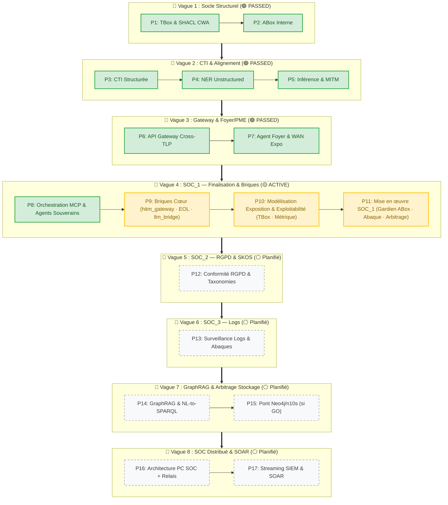
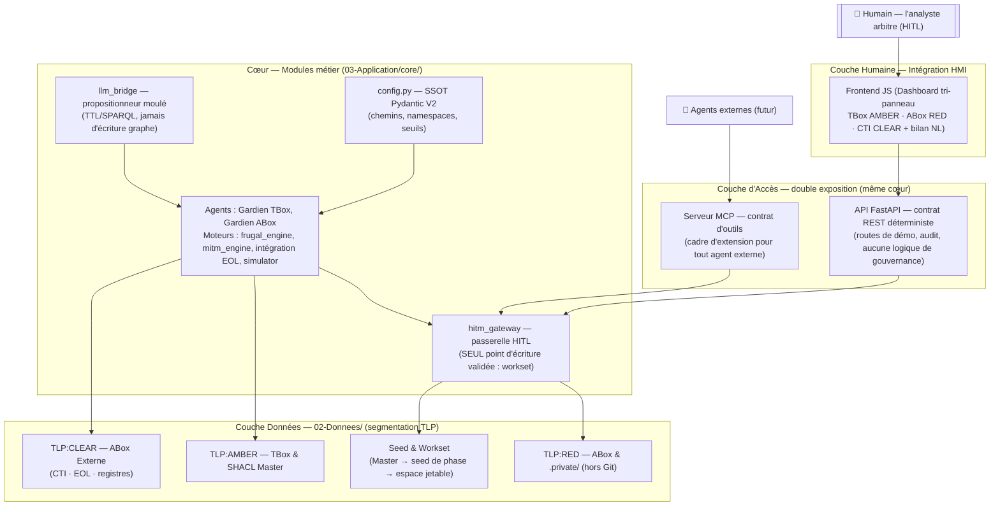
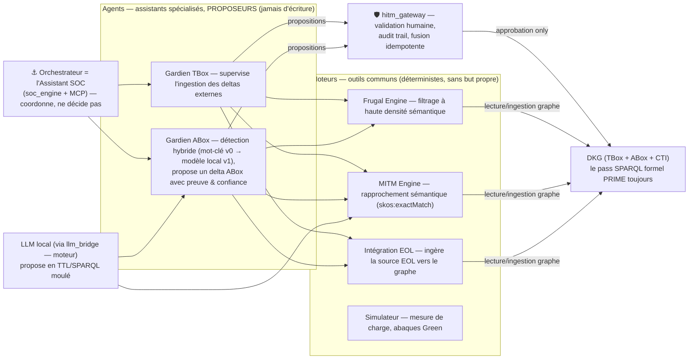

***Roadmap Produit & Backlog Évolutif : DKG-CyberSec & Agent IA SOC***

La roadmap est construite en 3 niveaux :
- ***Vague :*** Regroupement de principes pédagogiques intégrés dans le développement.
- ***Phase :*** Décomposition de la vague autour de sous-ensembles fonctionnels ou architecturaux.
- ***Étape :*** Application stricte commune à toutes les phases de développement "Spec-Driven".

---

## 0 - Périmètre SOC & Segmentation Fonctionnelle
Le cas d'usage SOC est décomposé en 3 groupes : 
**SOC_1** (Actifs, Vulnérabilités, Menaces),
**SOC_2** (Conformité/RGPD) 
**SOC_3** (Surveillance des Logs)


## 1 - Les Piliers Techniques Non Négociables

- **Adhérence W3C Stricte (100% OWL2 / SKOS / SHACL) :** Toute la logique repose sur des standards ouverts garantissant la traçabilité formelle, la réversibilité et la validation logique sous Closed World Assumption (CWA).
- **Sécurité & Isolation Native (TLP Matrix) :** Une ségrégation absolue et permanente des données garantit qu'aucun flux public (TLP:CLEAR) ne se mélange ou ne fuit vers les espaces sensibles (TLP:RED), malgré l'ingestion contrôlée de CTI externe.
- **Green-by-Design & Local-First :** L'architecture tourne en local et en mode isolé/étanche (Air-Gapped, poste standard 16 Go de RAM, sans GPU dédié), minimisant l'empreinte carbone.
- **Le Simulateur Évolutif & Banc d'Essai Transversal :** Un instrument de mesure intégré dès l'origine, qui évolue à chaque phase pour tester la montée en charge, le partitionnement et alimenter continuellement les abaques de performance.

---

## 2 - La Quête de la Limite et l'Arbitrage de Rupture (W3C vs Moteurs Propriétaires)

L'une des finalités majeures du projet est de pousser l'architecture W3C standard à son point de rupture absolu.
- **La démarche empirique :** Plutôt que d'adopter prématurément une base de graphes non-standard (type Neo4j), nous fatiguons le modèle standard par la montée en charge progressive, la croissance incrémentale et le calcul distribué sur l'Edge.
- **Le rôle du simulateur :** À travers notre banc d'essai et nos outils de simulation, chaque phase produit des abaques croisant volume de triplets, empreinte matérielle et temps de calcul, traçant objectivement la frontière entre la frugalité des standards W3C et la nécessité d'une base spécialisée.

---

## 3 - Vue Globale des Vagues Pédagogiques

[V1..3 - Phase 1-7 : Socle PoC & Métier] ➔ [V4 : SOC_1 — Finalisation & Briques] ➔ [V5 : SOC_2 — RGPD & SKOS] ➔ [V6 : SOC_3 — Logs] ➔ [V7 : GraphRAG & Arbitrage Stockage] ➔ [V8 : SOC Distribué & SOAR]

| Vague  | Titre & Horizon                                   | Sens & Principes Pédagogiques                                                                                                                 |     Statut     |
| :----: | :------------------------------------------------ | :-------------------------------------------------------------------------------------------------------------------------------------------- | :------------: |
| **V1** | Socle Structurel & Cartographie Interne           | Standards W3C (OWL2, SHACL) & Confidentialité native (TLP:RED).                                                                               | 🟢 **PASSED**  |
| **V2** | Ingestion CTI, NER & Alignement Primitif          | Superposition de graphes & Rapprochement sémantique (NER local).                                                                              | 🟢 **PASSED**  |
| **V3** | Industrialisation, Micro-Agents & Gateway         | Structure IA Agentique et API Gateway sécurisée (Cross-TLP).                                                                                  | 🟢 **PASSED**  |
| **V4** | **SOC_1 : Finalisation & Briques de Gouvernance** | Briques cœur développées seules (hitm_gateway, intégration EOL, llm_bridge), puis mise en œuvre SOC_1 (Gardien ABox, abaque 4 couches) concluant par l'arbitrage GO/NO-GO Neo4j. | 🟡 **ACTIVE**  |
| **V5** | SOC_2 : Conformité RGPD & Taxonomies SKOS | Réutilise les briques V4 sans nouvelle brique majeure attendue. Internationalisation (FR/EN), poly-hiérarchies. | ⚪ **Planifié** |
| **V6** | SOC_3 : Logs & Surveillance | Consomme la méthode abaque produite en V4. Montée en charge progressive, deltas, abaques de performance. | ⚪ **Planifié** |
| **V7** | GraphRAG & Arbitrage Stockage | Copilot NL-to-SPARQL et hybridation Neo4j/n10s, **conditionnée par l'arbitrage chiffré de V4** (on ne s'engage qu'avec les chiffres). | ⚪ **Planifié** |
| **V8** | SOC Distribué, Relais Edge & SOAR | PC SOC centraliseur + relais multi-OS et automatisation SOAR. | ⚪ **Planifié** |

### 3.1 - Vue Graph (Mermaid)




## 3.2 - Cartographie Technique & Architecture d'Agents (clé de lecture du nouveau venu)

Le découpage SOC_1/2/3 (fonctionnel) et les vagues (temporel) sont lus avec les trois repères techniques ci-dessous : **quatre couches**, **deux portes d'accès**, **une architecture d'agents**. Le lien entre fonction et architecture est ensuite résumé dans une table de correspondance.

### 3.2.1 - Les Quatre Couches (des données à l'humain)



**Pyramide de données** : Master Transversal (étalon) → seed de phase (Master clôturé + delta didactique, resettable) → workset (seul espace écrit par les agents/démo, RES_1). Le didactique ne remonte au Master que via validation HITL.

### 3.2.2 - Pourquoi Deux Portes : API et MCP

L'application expose **le même cœur** de deux façons complémentaires :

| Porte | Public | Nature | Rôle |
|---|---|---|---|
| **API FastAPI** | Humain (dashboard, recette curl) | Contrat REST déterministe | Auditer, piloter, vérifier — l'humain garde une entrée scriptable et vérifiable |
| **Serveur MCP** | Agents IA (Model Context Protocol) | Contrat d'outils découplé | Cadre d'extension : un nouvel agent est un **nouveau client MCP**, jamais une modification du cœur |

Règle structurante (décision A2) : **aucune logique de gouvernance ne vit dans les routes** — la passerelle HITL est une capacité du cœur, exposée par les deux portes. C'est ce qui évitera la dette en V4 (agents MCP) et au-delà.

### 3.2.3 - Architecture d'Agents : le « Qui Fait Quoi »



**Vocabulaire canonique** (détail au 01.2 § 1.quater) : une **source** est un référentiel de données (EOL, NVD, KEV) ; un **moteur** est un outil déterministe partageable, avec recette ; un **agent** est un assistant avec un but, qui mobilise des moteurs partagés et propose ; l'**orchestrateur** est l'Assistant SOC qui coordonne agents et moteurs. Règle anti-dérive : **un agent se reconnaît à son but, un moteur à sa recette** — l'EOL est une source ingérée par un moteur, pas un agent.

**Principes d'articulation (non négociables)** :
1. **Un agent propose, jamais n'écrit.** L'écriture validée passe uniquement par `hitm_gateway`, vers le workset.
2. **Le formel prime.** Après approbation, le pass SPARQL formel s'applique ; le mot-clé ne traite que ce qui n'est pas encore formalisé.
3. **Chaque proposition porte sa preuve** (provenance CTI + confiance + audit trail).
4. **La boucle vertueuse** : l'audit trail HITL accumule les paires (littéral, entité, décision humaine) = futur jeu d'entraînement du détecteur v1. Les rejets délimitent la politique autant que les approbations l'affinent.
5. **Dégradation gracieuse** : sans runtime LLM, `llm_bridge` bascule sur des templates figés — zéro token, service maintenu.

### 3.2.4 - Agents & Outils par Scope SOC (registre évolutif)

Chaque scope SOC se lit comme : **des agents (assistants avec un but) mobilisant des outils (briques techniques partageables)**. Les briques s'ajoutent au fil des vagues : un agent démarre avec l'outillage disponible (assistance v0) et monte en gamme à mesure que ses briques passent le statut PASSED — l'agent, lui, ne change pas de mission.

**État des outils** : ✔ disponible · 🚧 en cours (P9) · ◻ à développer (vague indiquée).

| Scope (Vague) | Agent — son but | Outils mobilisés (briques) |
|---|---|---|
| **SOC_1** (V4) | **Gardien TBox** — superviser l'ingestion des deltas externes, garantir la cohérence de l'ontologie | frugal_engine ✔ · intégration EOL 🚧 (P9) · SHACL/TBox ✔ · hitm_gateway 🚧 (P9, sas commun) |
| **SOC_1** (V4) | **Gardien ABox** — détecter les liens implicites du parc, proposer un delta ABox avec preuve | mitm_engine ✔ (mot-clé v0 / cosinus) · embeddings ✔ · llm_bridge ◻ (P9) · modèle local v1 ◻ (P11+) · hitm_gateway 🚧 |
| **SOC_1** (V4) | **Assistant SOC / orchestrateur** — auditer la superposition, hiérarchiser, recommander ; porte les assistances quotidiennes et périodiques du 01.2 § 1.bis.1 : réévaluation de l'existant (delta de statut KEV/CVSS/EOL), suivi des remédiations et clôture vérifiée (MTTR, régression), what-if avant modification du parc, hygiène/fraîcheur du graphe parc, santé du catalogue de sources, bilan de posture et tendance, assistance à la configuration du firewall (hiérarchisation par exploitabilité réelle, recommandations de durcissement — écriture = opérateur, automatisation = SOAR V8), assistance au durcissement des OS (Linux/Windows/iOS/Android : benchmarks publics en sources M2, posture de configuration du parc en M1, drift + recommandations — conformité réglementaire = SOC_2) | soc_engine ✔ · simulateur ✔ · abaque 4 couches ◻ (P11) · générateur de playbooks ◻ (P11) · bilan NL ✔ · what-if (lecture seule, requêtes SPARQL existantes) ◻ (P11) · suivi MTTR/dette ◻ (P11) · modélisation des règles de filtrage dans l'ABox Interne ◻ (P10, question ouverte spec P9) · modélisation de la posture de configuration OS dans l'ABox Interne ◻ (P10, questions ouvertes spec P9) · métrique d'exploitabilité (SPARQL) ◻ (P10) |
| **SOC_2** (V5) | *Agent conformité (à cadrer en V5)* — RGPD/NIS2, taxonomies SKOS, i18n | hitm_gateway (réutilisé) · SKOS poly-hiérarchies & labels multilingues ◻ (P12) · registres TLP:CLEAR ✔ |
| **SOC_3** (V6) | *Agent surveillance (à cadrer en V6)* — montée en charge logs, seuils | simulateur ✔ · méthode abaque (produite en P11) · ingestion logs par deltas ◻ (P13) |

**Règle de dépendance** : un agent ne peut être recetté qu'avec des outils PASSED ; si un outil manque, l'agent fonctionne en **assistance v0** (moteurs disponibles, mode dégradé) — jamais en mode suspendu.

**Périmètre des assistances** : les six assistances SOC_1 (quotidiennes et périodiques) sont définies dans le 01.2 § 1.bis.1 ; les assistances frontalières (NL-to-graph = V7 GraphRAG, conformité réglementaire = SOC_2, corrélation d'événements = SOC_3) restent en **perspectives** et ne doivent pas être anticipées.

**État d'outillage du démonstrateur** (lecture projet) :

| Outil | État dans la démo aujourd'hui | Cible |
|---|---|---|
| hitm_gateway | Logique dans les routes FastAPI (fonctionnel) | Refactor A2 en module `core/` (P9), exposition API+MCP |
| Détection implicites | Mot-clé `CONTAINS` v0 | Modèle local v1 + SPARQL formel premier (P11) |
| llm_bridge | Absent — aucun runtime LLM | Propositionneur moulé + templates figés en dégradé (P9) |
| Intégration EOL | En stand-by (templates, tests NonReg) | Moteur recetté (P9) |
| Abaque & playbooks | Non couverts | Abaque 4 couches + playbooks détaillés (P11) |

### 3.2.5 - Correspondance Fonction ↔ Architecture

| Scope (Vague) | Cas d'usage métier | Modules & agents mobilisés | Passages obligés |
|---|---|---|---|
| **SOC_1** (V4) | Inventaire, vulnérabilités, menaces, EOL | Gardien ABox, intégration EOL, frugal_engine, mitm_engine, simulateur, llm_bridge | hitm_gateway, SHACL, benchmark abaque → arbitrage Neo4j |
| **SOC_2** (V5) | Conformité RGPD, taxonomies SKOS, i18n | SKOS poly-hiérarchies, hitm_gateway (réutilisé) | SHACL, registres de conformité TLP:CLEAR |
| **SOC_3** (V6) | Surveillance des logs | Simulateur, méthode abaque, ingestion par deltas | Abaques de charge, seuils Green |
| **Transverse** (V7-V8) | GraphRAG, stockage, distribution, SOAR | llm_bridge, MCP, benchmarks multi-engine | Conditionnés par les arbitrages précédents |

### 3.2.6 - Contribuer en 5 Minutes

1. **Lire dans l'ordre** : README (vision & triptyque) → cette Roadmap (trajectoire + cartographie) → `01.1 Atelier` (traçabilité EXG↔tests) → `01.2 Architecture` (détail des modules).
2. **Une session = une étape bornée**, ouverte par le Pack de Démarrage de Session (vue LLM, TSV des exigences, `config.py`, fichier canonique désigné).
3. **Toute livraison est un fichier complet + sa recette** (commandes de vérification et résultat attendu). Rien n'avance tant que la recette ne passe pas.
4. **Toute analyse interroge le graphe** (SPARQL/rdflib) — jamais de regex sur les `.ttl`.
5. **Nouvelle brique ?** Spec `SPC-*` d'abord (cadrage), code + tests `EXG-*` ensuite. **Nouvel agent ?** Client MCP, jamais de logique dans les routes.

## 4 - Tableau Détaillé des Vagues & Phases (Niveau Micro)

| **Phase** | **Intitulé Fonctionnel & Technique**                   | **Objectif, Livrables & Matrice d'Exigences**                                                                                                                                                                                                                                                                                                                                                                                 | **Statut**     |
| --------- | ------------------------------------------------------ | ----------------------------------------------------------------------------------------------------------------------------------------------------------------------------------------------------------------------------------------------------------------------------------------------------------------------------------------------------------------------------------------------------------------------------- | -------------- |
| **P1**    | Socle TBox & SHACL CWA                                 | Ontologie Master OWL2, Validation SHACL sous CWA, SSOT (`config.py`).                                                                                                                                                                                                                                                                                                                                                         | 🟢 **PASSED**  |
| **P2**    | Cartographie ABox Interne                              | Modélisation des actifs locaux et vulnérabilités (`TLP:RED`).                                                                                                                                                                                                                                                                                                                                                                 | 🟢 **PASSED**  |
| **P3**    | Ingestion CTI Structurée                               | Flux NVD, CAPEC, CISA KEV (`TLP:CLEAR`).                                                                                                                                                                                                                                                                                                                                                                                      | 🟢 **PASSED**  |
| **P4**    | Ingestion CTI Textuelle (NER)                          | Extractor NLP Air-Gapped, validation SHACL du NER.                                                                                                                                                                                                                                                                                                                                                                            | 🟢 **PASSED**  |
| **P5**    | Agent MITM & Inférence Cascade                         | Inférence locale économe, réconciliation cosinus, cascade.                                                                                                                                                                                                                                                                                                                                                                    | 🟢 **PASSED**  |
| **P6**    | API Gateway & Ségrégation TLP                          | Contrôle d'accès strict TLP (CLEAR/AMBER/RED), audit log.                                                                                                                                                                                                                                                                                                                                                                     | 🟢 **PASSED**  |
| **P7**    | Micro-Agents & Box Résidentielle                       | Inventaire 5 actifs, analyse exposition WAN, contrat API REST.                                                                                                                                                                                                                                                                                                                                                                | 🟢 **PASSED**  |
| **P8**    | **Orchestration MCP & Moteurs d'Agents Souverains**    | **P8SOC Orchestrator & MCP :** Boucle d'agents via Model Context Protocol (`mcp_server.py`).<br>**Agents Actifs :** Gardien TBox, Gestion des données externes (filtrage frugal) et Simulateur de charge.<br>**Scope & Rapprochement :** TBox, actifs ABox (segmentation TLP) et catalogues externes (_Les Communs_).<br>**Green-by-Design :** Simulateur d'enrichissement et abaques de performance (recherche des limites). | 🟢 **PASSED**  |
|           |                                                        |                                                                                                                                                                                                                                                                                                                                                                                                                               |                |
| **P9**    | **Briques Cœur SOC_1** *(nouveauté 2026-11-17)* | **Brique 1 — hitm_gateway (option A2) :** refactor du contrôle HITL vers `core/hitm_gateway.py` (validation rdflib, audit trail, fusion idempotente), exposition API démo + MCP, re-validation du Golden Path.<br>**Brique 2 — Intégration EOL :** moteur d'ingestion de la source EOL (templates EOL, tests NonReg, mécanique sources CTI).<br>**Brique 3 — llm_bridge :** propositionneur moulé (TTL/SPARQL, jamais d'écriture graphe), autodétection ollama/llama.cpp, mode dégradé templates figés.<br>**Règle :** 1 brique = 1 étape bornée avec spec `SPC-*` + recette. **Aucune intégration applicative dans ce palier.** | 🟡**ACTIVE**   |
| **P10**   | **Modélisation Exposition & Métrique d'Exploitabilité** *(nouveauté 2026-11-18)* | **Brique 1 — TBox de l'exposition :** modélisation des règles de filtrage (zone, service, port, direction) et de la posture de durcissement OS (profil, contrôles benchmark frugaux) dans l'ABox Interne ; source de l'import (export vs re-saisie opérateur via hitm_gateway PASSED).<br>**Brique 2 — Métrique d'exploitabilité :** convention de pondération documentée (atteignabilité SPARQL × sévérité × facteurs de contrôle), calculable dans le graphe, **comparable entre contexts, reproductible par recette, sensible aux mitigations** — pas de score probabiliste invérifiable.<br>**Brique 3 — Requêtes d'atteignabilité :** pass SPARQL lecture seule (what-if) exploitable dès P11.<br>**Règle :** phase brique (TBox + requêtes + recette `SPC-*`), **aucune intégration applicative** — le rapport évolutionné qui consomme la métrique relève de P11. **Clôture = arbitrage documenté** (convention de pondération + granularité des contrôles benchmark retenus). | ⚪ **Planifié** |
| **P11**   | **Mise en œuvre SOC_1 & Arbitrage** | Intégration des briques PASSED uniquement : **Gardien ABox** (3 actes : détection hybride mot-clé v0 → modèle local v1 ; formalisation delta ABox validé HITL via workset ; le pass SPARQL formel prime), simulateur personas (Foyer → ETI), **abaque 4 couches data** (repos distants / fichiers / RAM / distribution), benchmark W3C pur vs Oxigraph/Neo4j. **Clôture = décision GO/NO-GO Neo4j documentée** (l'arbitrage de rupture). | ⚪ **Planifié** |
| **P12**   | SOC_2 : RGPD & **Taxonomies SKOS & Poly-hiérarchies** | **Sémantique :** Internationalisation (FR/EN), nuances taxonomiques et versioning incrémental. Consomme les briques V4 (hitm_gateway), aucune nouvelle brique majeure attendue. | ⚪ **Planifié** |
| **P13**   | SOC_3 : **Logs** | **Banc d'Essai :** Montée en charge progressive, génération de deltas et abaques de performance — par la méthode abaque produite en P11. | ⚪ **Planifié** |
| **P14**   | **GraphRAG & Copilot SOC Explicable** | **IA Applicative :** Assistant conversationnel local (NL-to-SPARQL) et graphes de preuves RDF. | ⚪ **Planifié** |
| **P15**   | **Multi-Engine Storage : Hybridation Neo4j** | **Technique :** Comparatif Triple Store W3C vs Neo4j/n10s et analyse formelle des pertes sémantiques. **Conditionné par la décision GO/NO-GO de P11.** | ⚪ **Planifié** |
| **P16**   | **Architecture SOC Distribué & Relais** | **Infrastructures :** PC SOC centraliseur sur LAN + agents relais légers (Windows/Android). | ⚪ **Planifié** |
| **P17**   | **Streaming SIEM & SOAR Adaptatif** | **Temps Réel :** Ingestion continue d'événements et génération automatique de scripts de remédiation. | ⚪ **Planifié** |


## 4.bis - Principes de Découpage Agile (acté 2026-11-17)

> Retour d'expérience P8 : une phase qui mélange briques techniques, intégration applicative et livrables didactiques devient ingérable. La reprise acte trois axes séparés : **briques techniques** (bibliothèques transverses), **scopes métier SOC_x** (consommateurs), **piste didactique** (vidéo/démo, consomme uniquement du PASSED, ne bloque jamais).

1. **Une vague = un scope métier SOC.** V4 = SOC_1, V5 = SOC_2, V6 = SOC_3. Les briques se développent DANS la vague dont elles dépendent, en palier dédié.
2. **Loi de séparation brique/application :** une phase produit soit une brique (bibliothèque + tests + recette curl), soit une intégration applicative de briques déjà PASSED. Jamais les deux en même temps.
3. **Budget de phase :** ~10 exigences nouvelles maximum et 3 sessions. Au-delà, split obligatoire au cadrage (nouveau critère du Gatekeeper inter-phases GOU_4), pas en cours de route.
4. **Definition of Done :** critères d'entrée/sortie explicites dans la spec ; la recette fait partie du livrable ; clôture de scope = un arbitrage documenté (V4 : GO/NO-GO Neo4j), pas seulement « ça marche ».

## 5. Vue LLM
```
[CONTEXT: DKG-CyberSec Architecture & Roadmap]
- CORE PILLARS: Strict W3C (OWL2, SKOS, SHACL-CWA), Air-Gapped TLP Matrix (CLEAR/AMBER/RED), Green-by-Design local-first, evolutionary benchmarking.
- WAVES OVERVIEW:
  * V1 (Passed): Structural Core & Internal ABox.
  * V2 (Passed): CTI Ingestion, NER & Semantic Alignment.
  * V3 (Passed): Micro-Agents & Cross-TLP Gateway.
  * V4 (Active): SOC_1 Finalization — bricks first (P9 core bricks, P10 exposure & exploitability modeling), then implementation & Neo4j GO/NO-GO arbitration (P11).
  * V5 (Planned): SOC_2 — GDPR & SKOS.
  * V6 (Planned): SOC_3 — Logs & abacus method.
  * V7 (Planned): GraphRAG & storage arbitration (conditioned by V4 figures).
  * V8 (Planned): Distributed SOC & SOAR.
- AGILE SLICING RULE (acted 2026-11-17): one wave = one SOC scope; one phase = EITHER a technical brick (library + tests + curl recipe, no app integration) OR an application integration of PASSED bricks — never both. Max ~10 new requirements and 3 sessions per phase, else split at framing time.
- CANONICAL VOCABULARY & AGENT REGISTRY: SOURCE = data reference; ENGINE/module = deterministic shared tool with a recipe; AGENT = specialized assistant with a goal, uses shared engines via MCP, proposes — never decides/writes (SOC_1: TBox Guardian, ABox Guardian, SOC orchestrator; SOC_2/SOC_3 agents to be framed); ORCHESTRATOR = the SOC Assistant itself. Agent registry by SOC scope in §3.2.4: agents start with available tools (assistance v0) and gain capability as their bricks reach PASSED; an agent is only accepted for recette with PASSED tools, otherwise it runs degraded — never suspended. Demonstrator tool state tracked in §3.2.4 (hitm in routes today, keyword v0, no llm_bridge, EOL stand-by, abacus & playbooks to build).
- SOC_1 DAILY & PERIODIC ASSISTANCES (acted 2026-11-18, defined in Architecture 01.2 §1.bis.1, carried by the SOC orchestrator): (1) re-evaluation of existing findings on external status deltas (KEV/CVSS/EOL/exploit-availability), (2) remediation tracking & verified closure (MTTR, debt, regression on rollback/reintroduced components), (3) what-if impact analysis before any park change (read-only SPARQL, pre-write), (4) park graph hygiene & freshness (orphans, missing versions, stale scans), (5) source catalog health (delta freshness, signal vs noise, silent/redundant sources), (6) periodic posture report & trends (severity drift, debt curve, remediable posture KPIs); (7) firewall configuration assistance (acted 2026-11-18): import filtering rules as park data, rank findings by real exploitability (presence ≠ exploitability), flag permissive/redundant/stale rules, recommend hardening simulated via what-if — recommendations only, writing rules is an operator act, automating them is SOAR (V8); open spec-P9 question: how to model filtering rules in the Internal ABox; (8) OS hardening assistance (acted 2026-11-18): same pattern as firewall — public hardening benchmarks (CIS, ANSSI) as M2 sources (External ABox), per-asset configuration posture as M1 park data (Internal ABox), drift detection + prioritized hardening recommendations via what-if; boundaries: recommendation only (applying = operator, automating = SOAR V8), technical posture not regulatory compliance (SOC_2), generic benchmark capture (no query fingerprint — confrontation is local).
- FRUGAL VOLUME HANDLING (acted 2026-11-18, defined in Architecture 01.2 §1.bis.2, illustrated with mermaid): external references for assistances 7/8 (benchmarks, catalogs, firewall rules) are voluminous; two Green-Dev axes — (1) selective capture (catalog describes volumetry per descriptor BEFORE download; capture only high-semantic-density deltas, frugal control subsets, never full references), (2) task-decomposed processing (sequential bounded tasks: semantic tri, mapping, SHACL; disk-backed delta buffer, never full volume in RAM; per-lot checkpoints for resume; sequential by default, parallelism only as a measured optimization). Reduced-resource compatibility is a STRUCTURAL property of the pipeline, not a tuning. Borderline assistances stay in perspectives and must NOT be anticipated: NL-to-graph (V7 GraphRAG), regulatory compliance (SOC_2), event correlation (SOC_3).
- GUIDING-THREAD SCENARIO (acted 2026-11-18, full doc: 01.3 - Scenario_Fil_Directeur.md): one pilot storyline — "Foyer domotic server", EOL component + critical KEV CVE, 3 contexts (exposed/filtered/hardened+filtered) — drives P9 to P11: Step0 = P8 demonstrator as-is; Step1 = P9 bricks (EOL integration, hitm_gateway operator declaration of firewall rules & hardening posture, llm_bridge degraded recommendations) consuming the P10 exposure TBox; Step2 = evolved report splitting vulnerability (presence, External ABox) from exploitability (exposure, Internal ABox) with per-context prioritization; Step3 = what-if → operator-applied mitigation → re-evaluation (exploitability drops to zero, vulnerability still traced); Step4 = verified closure, MTTR, regression on rollback. Never consumes a non-PASSED brick; degrades to assistance v0. EXG-P9 candidates from the scenario: evolved report (vulnerability×exploitability), firewall-rule & hardening-posture modeling in the Internal ABox, read-only what-if, verified closure/regression/MTTR, frugal pipeline as non-functional requirement.
- PHASES DETAIL:
  * P1-P2 (Passed): TBox/SHACL ontology & Internal ABox mapping (`TLP:RED`).
  * P3-P5 (Passed): Structured CTI (`TLP:CLEAR`), Air-Gapped NER extraction, MITM cosine matching & inference cascade.
  * P6-P7 (Passed): Cross-TLP API Gateway & Residential micro-agents box.
  * P8 (Passed): P8SOC Orchestrator, Model Context Protocol (`mcp_server.py`), TBox Guardian, Frugal CTI engine, HITM validation, Green-by-design benchmarking.
  * P9 (ACTIVE): SOC_1 core bricks, one brick = one bounded session — hitm_gateway refactor (option A2, Golden Path re-validation), EOL integration engine (ingests the EOL source; templates + NonReg tests), llm_bridge (molded proposer, never writes the graph; ollama/llama.cpp autodetect; degraded mode = fixed templates). No app integration in this phase.
  * P10 (Planned, added 2026-11-18): exposure & exploitability brick phase — TBox modeling of filtering rules (zone/service/port/direction) and OS hardening posture (frugal benchmark control subset) in the Internal ABox; documented exploitability metric (SPARQL reachability × severity × control factors — comparable across contexts, reproducible by recipe, sensitive to mitigations; no unverifiable probabilistic score); read-only reachability/what-if SPARQL pass. Brick phase only (TBox + queries + SPC recipe), no app integration — the evolved report consuming the metric belongs to P11. Closure = documented arbitration (weighting convention + benchmark granularity).
  * P11 (Planned): SOC_1 implementation & arbitration — PASSED bricks only: ABox Guardian (3 acts: hybrid detection keyword v0 → local model v1; HITL-validated delta ABox via workset; formal SPARQL pass prevails), simulator personas (Foyer → ETI), 4-layer data abacus, W3C-pure vs Oxigraph/Neo4j benchmark → documented GO/NO-GO Neo4j decision.
  * P12 (Planned): SOC_2 — GDPR, SKOS taxonomies & poly-hierarchies (reuses V4 bricks).
  * P13 (Planned): SOC_3 — load logs & performance abacuses (abacus method from P11).
  * P14-P15 (Planned): GraphRAG NL-to-SPARQL, Neo4j n10s hybridization (only if P11 says GO).
  * P16-P17 (Planned): Distributed SOC relays & automated SOAR.
```


## 6. Specification prospective
