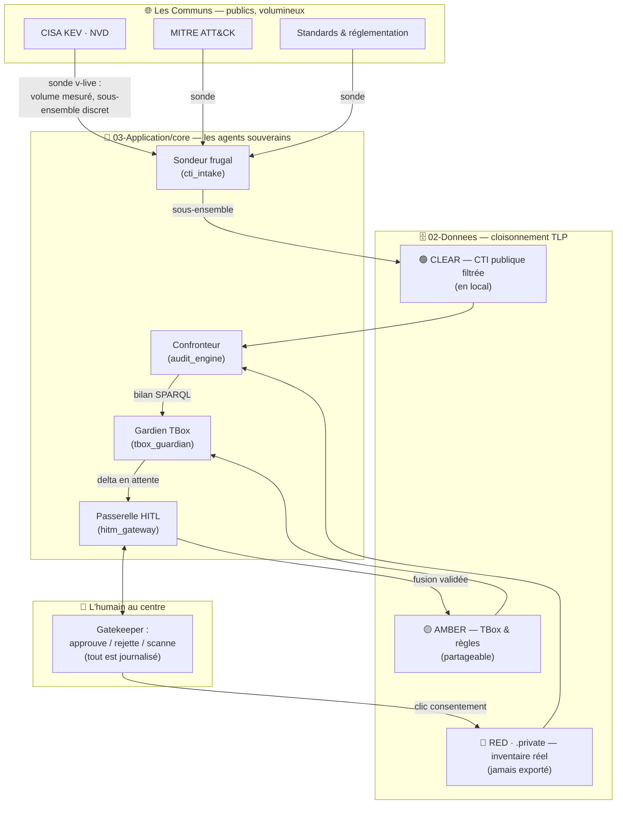

# 🎬 Storyboard — DKG-CyberSec : la vidéo
**Réf.** STORY-P8-video_01 · **Durée cible** : 18-22 min · **Ton** : conviction pédagogique, preuve à l'appui
**Prérequis tournage** : démo recette verte sur les 3 terrains, ratios v-live mesurés, audit trail HITL rempli.

---

## 🎯 Thèse de la vidéo (le fil rouge, à dire en ouverture ET fermeture)

> **Knowledge Graph + LLM = concilier Confidentialité et Green Dev.**
> Les standards (OWL, RDF, SKOS, TLP) garantissent efficacité et intégrabilité.
> On articule les communs publics (CTI, CVE) avec les connaissances privées
> sans crouler sous le volume — frugalité mesurée, preuve à l'appui.
> Toujours l'humain au centre (HITL), dans une amélioration continue,
> portée par une structure agentique qui maintient la rigueur du standard
> à chaque étape. Et la preuve ultime : les simulateurs caractérisent les
> limites tenables de cette adhérence stricte.

---

## ACTE 0 — Ouverture : un projet, une conviction (2 min)

| Plan | Visuel | Narration (indicative) |
|---|---|---|
| 0.1 | Écran noir, titre : *« Concilier Confidentialité et Green Dev ? »* | « Chaque jour, des flux de cybermenaces publics explosent en volume. Chaque jour, un SOC doit croiser cette masse avec SON inventaire — confidentiel, lui. Le réflexe habituel : tout rapatrier, tout indexer, tout envoyer au cloud. Conviction défendue ici : c'est une impasse. Il existe une autre voie. » |
| 0.2 | Split-screen : logos standards (W3C RDF/OWL/SKOS, TLP) vs cartes de vulnérabilités | « Les standards du web sémantique offrent une garantie rare : efficacité du raisonnement ET intégrabilité. Un graphe conforme à OWL se confronte, s'aligne, se fusionne — mécaniquement, pas par magie de prompt. » |
| 0.3 | Le schéma Design simplifié (cf. Annexe A) animé couche par couche | « Ce projet, DKG-CyberSec, le prouve par un démonstrateur : des agents souverains, un graphe segmenté TLP, l'humain qui valide chaque extension — et une frugalité que l'on MESURE en octets. » |
| 0.4 | Titre : *« Un projet, un démonstrateur, une conviction »* | Annonce du plan : le tuto application, la méthode spec-driven, le design, la démo des 3 terrains, les domaines d'application, les limites prouvées. |

---

## ACTE 1 — Tuto Application (4 min)

### 1.1 Installation (1 min 30)
- Clone du workspace ; arborescence : `01-Specs/`, `02-Donnees/` (segmenté TLP:AMBER/RED/CLEAR), `03-Application/` (core agents, api, static).
- `python -m venv` + `pip install -r requirements.txt` (rdflib, fastapi, uvicorn, pydantic v2, requests).
- `python 03-Application/main.py` → uvicorn sur 127.0.0.1:8000.
- Insister : **zéro clé API, zéro service cloud** — Air-Gapped by design (GOU_13). Le premier lancement fonctionne réseau coupé.

### 1.2 Utilisation (2 min 30) — séquence UI rapide (le détail pédagogique est en Acte 4)
- Ouverture : la TBox s'affiche seule (l'ossature historique) — message didactique en tête.
- Les 3 boîtes TTL : AMBER (ontologie), RED (inventaire), CLEAR (menaces) — le marquage TLP comme **cloisonnement visible**.
- Le sélecteur de terrain, les cases à cocher (consigne réseau), les boutons Analyse / Scanner / Reset.
- Pointer : le badge « 0 requête — Air-Gapped ». « Rien ne part. Rien n'arrive. Tant que vous ne le décidez pas. »

---

## ACTE 2 — Tuto Méthodo : Spec-Driven avec assistant LLM (4 min)

### 2.1 Le spec-driven (1 min 30)
- Montrer `SPC-MET-P8-demonstrateur_phase8_01.md` (rév. 2) dans Obsidian : frontmatter YAML, exigences EXG-*, matrice de tests.
- « Chaque ligne de code cite l'exigence qu'elle couvre. Le code n'est jamais orphelin de son intention. »
- Montrer la révision 2 : « La spec a VÉCU — les exigences DEM_6 (frugalité v-live) et DEM_7 (HITL de scan) sont nées des recettes, pas d'un bureau. C'est l'amélioration continue appliquée à la spécification. »

### 2.2 Obsidian + Dataview : consolidation (1 min)
- Vue Dataview : tableau des exigences par statut, couverture spec ↔ tests (`test_phase8_demonstrator.py` ↔ EXG-*).
- « L'atelier Obsidian est le tableau de bord de la rigueur : une exigence sans test est visible, un test sans exigence aussi. »

### 2.3 Le partage LLM : TSV & prompts (1 min 30)
- Montrer le bloc 7 de la spec : matrice d'invariants TSV (RULE_SUMMARY → TEST_ASSERTION), pointers, system prompt d'amorce.
- « Le TSV est le contrat minimal entre l'humain et le LLM : des invariants formels, pas de la prose. Le prompt d'amorce impose trois règles — citer l'UID, jamais toucher la TBox sans HITL, alerter si une spec parente est impactée. »
- Exemple live : coller l'anchor dans une session LLM, demander une évolution, montrer que la réponse cite les EXG.

---

## ACTE 3 — Le Design, expliqué (3 min)

> 📌 Remplacer le mermaid dense d'Architecture.md par le **schéma en 5 couches** (Annexe A) — même information, lecture en 15 secondes.

- **Couche Communs** : CISA KEV, NVD, MITRE ATT&CK — publics, volumineux, en croissance.
- **Couche Données (02-Donnees/)** : le cloisonnement TLP est LE concept sécurité — AMBER (l'ontologie, partageable), RED (.private/, jamais versionné, jamais exporté), CLEAR (le public filtré en local).
- **Couche Agents (core/)** — les nommer un par un, rôles en une phrase :
  - *Local volumes* : le bibliothécaire SSOT — qui lit quoi, selon le terrain.
  - *CTI intake* : le sondeur frugal — mesure le volume distant, ne télécharge qu'un sous-ensemble discret.
  - *Audit engine* : le confronteur — SPARQL sur le graphe, jamais de regex sur le texte.
  - *TBox Guardian + HITM gateway* : le douanier et le juge — un vocabulaire inconnu est BLOQUÉ jusqu'à validation humaine.
  - *Mermaid views / Frugality metrics* : les pédagogues — rendre visible le raisonnement et le coût.
  - *Scan terrain* : le collecteur consentiel — scan réel uniquement sur clic journalisé.
- **Couche Accès** : routeur fin (valider, déléguer, renvoyer) + UI tri-boîtes.
- **Message clé** : « La structure agentique garantit la rigueur du standard à CHAQUE étape — aucun agent ne peut contourner le marquage TLP, le HITL, ou le SSOT. »
- Mention architecture cible : le Gardien ABox (§37, liens implicites) — la prochaine marche.

---

## ACTE 4 — LE Démonstrateur : les 3 terrains (6 min — cœur de la vidéo)

**Règle de tournage** : chaque terrain suit le même rythme — *action attendue → résultat Turtle → résultat graphique → enseignement*.

### 4.1 Terrain FOYER (2 min 30) — la boucle didactique complète
1. Reset. Badge « 0 requête — Air-Gapped ». Audit sans CTI → **silence total** (0 vulnérabilité : l'inventaire pur ne sait rien). *« Retenez ce silence : il est la preuve que le graphe ne préjuge de rien. »*
2. Cocher CISA KEV → volet CLEAR : **les ratios v-live** — distant sondé, téléchargé, persisté, RAM. *« On a consulté une source de X Ko, on n'a gardé que Y Ko. La frugalité n'est pas un slogan, c'est un compteur. »*
3. Audit → finding **Camera Surveillance IP — FreeRTOS — CVSS 9.8** + carte Gardien : 3 propriétés inconnues (`exploitsWeakness`, `isCisaKev`, `targetsDevice`).
4. **Le moment fort — le REJET** : cliquer Rejeter → vue superposition caméra → « ⚠️ LIAISON PARTIELLE », maillon CWE marqué ⚠️. *« Regardez ce que coûte le refus : le finding reste, mais la chaîne de raisonnement est coupée. L'écart reviendra à chaque audit — la gouvernance n'oublie pas. »*
5. Ré-audit → la proposition revient (traçabilité) → **Approuver & Fusionner** → vue superposition → « ✓ LIAISON FORMELLE », chaîne complète jusqu'à **Mirai → Caméra IP → votre caméra**. *« L'humain a parlé, l'ontologie a grandi, le raisonnement est complet — et tout est journalisé. »*
6. Vue graphique TBox : la relation `ThreatActor → DeviceCategory` est apparue. *« Le recallage validé est visible dans l'ontologie elle-même. »*

### 4.2 Terrain SI HÔTE (1 min) — le cas serveur, la même mécanique
1. Basculer le terrain, cocher NVD → requêtes ciblées par CVE (discrétion : seuls des identifiants publics partent).
2. Audit → Log4Shell 10.0 + Path Traversal 7.5, liaison formelle directe.
3. *« Autre terrain, autre profil de menace — même mécanique, zéro code spécifique. C'est l'intégrabilité du standard au travail. »*

### 4.3 Terrain POSTE RÉEL (1 min 30) — la preuve que rien n'est scripté
1. Cliquer « 🖥️ Scanner mon poste » → confirmation → ligne `SCAN_APPROVE` dans l'audit trail.
2. Audit → confronter les **vraies** versions aux fonds. Deux issues, toutes deux bonnes à filmer :
   - finding réel (ex. composant détecté matché) → « la chaîne vient de toucher VOTRE machine » ;
   - ou 0 finding → « preuve que le matching est réel, pas truqué : votre poste n'a pas de composant référencé dans le fonds coché. La connaissance manquante est aussi une information. »
3. Reset → le scan est **toujours là** (.private/, fait d'observation durable) ; le buffer CTI est purgé.
4. *« Réseau coupé maintenant ? La démo survit intégralement. »* (le montrer si le contexte s'y prête)

### 4.4 Clôture démo (30 s)
- L'audit trail complet : approbations, rejet, scan — l'histoire de la session, signée par l'humain.
- L'abaque Green-Dev : volume chargé vs magasin, top entités. *« Voilà le Green Dev : pas une intention, une mesure. »*

---

## ACTE 5 — Application à d'autres domaines (1 min 30)

Diapos rapides, une phrase chacune — la grille de lecture reste : *communs publics + privé confidentiel + humain validateur* :
- **Santé** : croisement littérature/sciences (PubMed, CIM-11) × dossiers patients — sans que les dossiers ne partent.
- **Juridique/Conformité** : réglementation publique (NIS2, RGPD) × SI interne — veille frugale sur des corpus de plusieurs Go.
- **Industrie/Maintenance** : documentation constructeurs × télémétrie d'usine — obsolescence de composants à la FT.
- **Achats/Supply chain** : SBOM et vulnérabilités publiques × fournisseurs sous NDA.
- Phrase de liaison : « Partout où des connaissances publiques massives doivent raisonner sur des connaissances privées sans les divulguer — cette architecture s'applique. »

---

## ACTE 6 — La preuve ultime : les limites tenables (2 min)

- Montrer `simulator.py` / les abaques : montée en charge, mesure du temps de raisonnement et de la RAM.
- « L'adhérence stricte au standard W3C pur a un coût. Nous ne le nions pas — nous le CARACTÉRISONS. Les simulateurs établissent où la voie reste tenable, et où il faut une base spécialisée (ex. graphe natif) : c'est la thèse de sobriété SOC — un SOC sobre SANS GPU 16 Go. »
- Courbes à l'écran : volume CTI vs temps d'audit ; nb actifs vs RAM. Le point de bascule est LIVRÉ, pas subi.

---

## ACTE 7 — Fermeture (1 min)

- Revenir sur le schéma 5 couches, puis visage caméra :
> « On nous demande de choisir : la puissance des LLM ou la confidentialité, l'exhaustivité des données ou la sobriété. Ce projet montre que le standard bien appliqué, l'agent frugal et l'humain au centre rendent le choix inutile. Le démonstrateur tourne, la mesure existe, les limites sont écrites. La suite : à vous de confronter votre terrain. »
- Carton final : repo, spec rév. 2, contact.

---

## 📐 Annexe A — Schéma Design (remplace le mermaid d'Architecture.md)

**Pourquoi plus lisible** : 5 blocs nommés en français, 3 flux seulement (sonder → confronter → valider), l'humain en position centrale. L'original d'Architecture.md reste en annexe technique du dépôt.

## 📐 Annexe B — Grille de tournage par plan (rappel)

| Acte | Support | À capturer | Durée |
|---|---|---|---|
| 0 | Titres + schéma A | 4 plans | 2 min |
| 1 | Terminal + navigateur | install complète, 1er lancement, UI vierge | 4 min |
| 2 | Obsidian + éditeur + session LLM | frontmatter, Dataview, TSV, prompt, réponse citant EXG | 4 min |
| 3 | Schéma A animé + 1 slide/agent | couches une à une | 3 min |
| 4 | Navigateur démo | ratios, finding caméra, REJET (PARTIELLE), fusion (FORMELLE), TBox graph, scan réel, audit trail, abaque | 6 min |
| 5 | Diapos | 4-5 domaines | 1 min 30 |
| 6 | Courbes simulateur | abaques + point de bascule | 2 min |
| 7 | Schéma A + caméra | fermeture conviction | 1 min |
