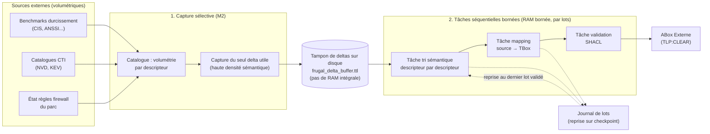
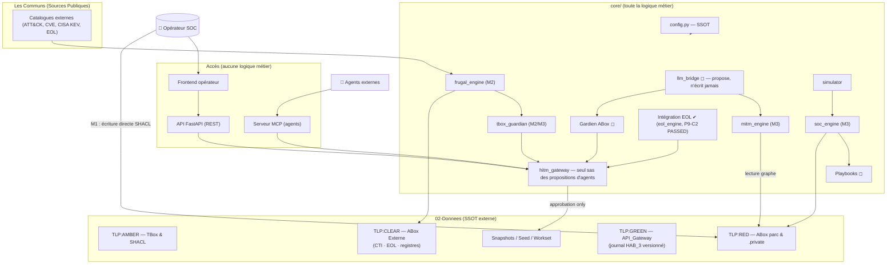

# 01.2 - Architecture

> **Version canonique 2026-11-17.** Restructuration : l'architecture est lue à travers le
> contrat fonctionnel de l'Assistant SOC_1 (3 missions). Chaque module porte son statut :
> ✔ existant · 🚧 refactor en cours (P9) · ◻ planifié (acté).
> Ancienne version : historique, ne pas utiliser.

## 0. Objet de l'application

L'application est un **Assistant SOC** (scope **SOC_1** à ce stade : Actifs, Vulnérabilités,
Menaces). Il ne remplace pas l'analyste : il maintient la carte, surveille les sources
publiques, confronte les deux et recommande. **Le LLM propose sans jamais écrire ; le graphe
garantit ce qui est écrit ; l'humain arbitre.**

## 1. Le Contrat Fonctionnel : les Trois Missions SOC_1

| Mission | Énoncé | Livrable attendu | Régime d'écriture |
|---|---|---|---|
| **M1 — État des lieux** | Maintenir la carte du parc machine & réseau : ajouter, modifier l'architecture du parc | ABox TLP:RED à jour (actifs, composants, topologie) | **Direct opérateur** : écriture graphe validée SHACL, provenance + horodatage. Pas de boucle HITL (l'humain écrit lui-même) |
| **M2 — Sources externes** | Maintenir la liste des sources externes utiles pour identifier les vulnérabilités | Catalogue curaté `external_sources` (TLP:CLEAR) + deltas filtrés | **Gouverné** : ajout/retrait de source = décision opérateur journalisée |
| **M3 — Confrontation** | Croiser M1 × M2 pour identifier, hiérarchiser et recommander | Findings + bilan hiérarchisé (CVSS, CISA KEV, exposition WAN, EOL) + **playbooks de remédiation détaillés** (ammorce SOAR, acté 17/11) | **Lecture seule** pour le diagnostic ; recommandations = propositions, jamais d'écriture graphe |

**Frontières actées (17/11/2026)** :
1. M3 « recommander » = conseil **+ playbooks détaillés** (préfiguration de la vague SOAR V8).
2. M1 = **modification directe du graphe** par l'opérateur : la boucle HITL
   (`hitm_gateway`) vaut pour les **propositions d'agents** (enrichissement TBox,
   delta ABox proposé par le Gardien ABox), pas pour l'entretien du parc par l'humain.
   Deux régimes d'écriture, une seule règle : toute écriture est validée SHACL et
   n'atteint jamais le Master sans validation explicite (pyramide ci-dessous).

**Pyramide de données** : Master Transversal (étalon, replay gouverné) → seed de phase
(Master clôturé + delta didactique, resettable, RES_1) → **workset** (seul espace écrit
par la démo/les agents). Le didactique ne remonte au Master que via validation HITL.

## 1.bis - Apports de l'Assistant IA (les aides apportées aux missions)

Les trois missions sont celles de l'analyste ; l'assistant IA lui apporte quatre
aides transversales. **Aide ≠ décision** : l'assistant détecte, propose, recommande —
l'humain écrit et arbitre.

1. **Cohérence de la TBox dans ses évolutions** (rôle Gardien) : supervision de chaque
   proposition d'enrichissement (vocabulaire déclaré, doublons, axiomes), recommandations
   d'alignement (SKOS, `owl:equivalentProperty`), garde de l'ontologie-avant-sources.

2. **Cohérence de l'ABox interne dans ses évolutions** (rôle Gardien ABox) : détection
   des liens implicites non formalisés (littéraux, services exposés), proposition de
   delta ABox avec preuve et confiance, validation HITL, puis le formel prime.

3. **Cohérence ET SOBRIÉTÉ de l'ABox Externe** (CTI, EOL et autres apports publics) : profiter des communs sans
   réinventer, sans charger les référentiels complets en local (filtrage frugal à haute
   densité sémantique). **Contrainte de discrétion** : des requêtes trop ciblées sur les
   sources publiques divulgueraient indirectement la composition du parc privé
   (empreinte de requête). L'assistant privilégie donc la **capture périodique large**
   (deltas de catalogues) à l'interrogation ciblée (CVE par CVE), et le croisement
   parque×sources se fait **en local**, après capture — jamais côté source.

4. **Analyse de la superposition des graphes** : faire ressortir les vulnérabilités du
   croisement TBox × ABox parc × CTI, tant **formelles** (pass SPARQL, findings
   raisonnés, hiérarchisation CVSS/KEV/exposition/EOL) qu'**implicites** (mot-clé,
   rapprochement sémantique cosinus) — le formalisme n'étant jamais qu'un
   delta d'approbation HITL derrière l'implicite (boucle vertueuse).

### 1.bis.1 - Assistances quotidiennes et périodiques (SOC_1, acté 18/11/2026)

La boucle quotidienne de l'analyste — import des deltas externes + réévaluation
interne (post-mitigation) → état des lieux → vulnérabilités hiérarchisées et
recommandations — est le cœur battant de SOC_1. Huit assistances complémentaires
l'entourent, toutes conformes aux régimes d'écriture (lecture seule ou
propositions HITL, jamais d'écriture directe par l'assistant) :

1. **Réévaluation de l'existant** : la valeur d'une source ne réside pas que dans
   ses nouvelles lignes, mais dans ses **changements d'état** — un CVE déjà connu
   qui passe en CISA KEV, un CVSS réévalué, une date EOL annoncée, un exploit rendu
   public. L'assistant détecte le delta de **statut** et ré-agit sur la priorisation
   des findings existants, distinct de l'import du nouveau.
2. **Suivi des remédiations et clôture vérifiée** : après implémentation d'une
   mitigation, confronter l'état revendiqué du parc au graphe — finding réellement
   clos ? **régression** (rollback, composant vulnérable réintroduit) ? Dette :
   findings ouverts par âge, MTTR, taux de recouvrement.
3. **Analyse d'impact préalable (what-if)** : avant un ajout/modification du parc
   (M1), simuler l'impact en lecture seule — « si j'expose ce service sur cette
   zone, quels findings/expositions en résultent ? ». La confrontation M1×M2 jouée
   en prospective, avant l'écriture opérateur.
4. **Hygiène et fraîcheur du graphe parc (M1)** : actifs orphelins, composants sans
   version ni source, état des lieux périmé (dernier scan daté de X jours),
   incohérences topologiques. Sans cette assistance, les recommandations M3 se
   dégradent silencieusement.
5. **Santé du catalogue de sources (M2)** : fraîcheur des deltas par source,
   volumétrie utile vs bruit, sources muettes ou redondantes → recommandations
   d'ajustement du catalogue. La métrologie de M2, alignée sur la sobriété.
6. **Bilan de posture et tendance** : consolidation périodique (semaine/mois) —
   évolution des findings par sévérité, courbe de dette, KPI de posture remédiable.
   L'état de sortie de la boucle quotidienne, adressable à une revue de direction.
7. **Assistance à la configuration du firewall (acté 18/11)** : les règles de
   filtrage conditionnent l'**exploitabilité** des vulnérabilités — un CVE critique
   sur un service isolé par un firewall strict n'appelle pas la même urgence que
   le même CVE exposé sur le WAN. L'assistant (a) importe l'état des règles de
   filtrage comme donnée du parc (M1), (b) hiérarchise les findings M3 selon
   l'exposition réelle (présence ≠ exploitabilité), (c) détecte règles
   permissives, redondantes ou obsolètes, et (d) **recommande** un durcissement
   (règle à resserrer, à ajouter, à retirer) avec le what-if de l'assistance 3
   pour en simuler l'effet. **Recommandation uniquement** : l'écriture de règles
   firewall est un acte opérateur ; leur automatisation relève du SOAR (V8).
   *Question ouverte pour la spec P9 : modélisation des règles de filtrage dans
   l'ABox Interne (zone, service, port, direction) et source de l'import
   (export firewall vs re-saisie opérateur).*
8. **Assistance au durcissement des systèmes d'exploitation (acté 18/11)** :
   même mécanique que le firewall, appliquée à la configuration des OS —
   Linux, Windows, iOS, Android. Les référentiels publics de durcissement
   (ex. CIS Benchmarks, guides ANSSI) sont des **sources** à cataloguer (M2,
   apports de l'ABox Externe, TLP:CLEAR) ; la posture de configuration de
   chaque actif du parc (durcisseurs appliqués, services actifs, politiques)
   est une **donnée du parc** (M1, ABox Interne, TLP:RED). L'assistant
   confronte l'une à l'autre : détection des écarts (drift de configuration),
   hiérarchisation des findings par surface d'attaque réellement ouverte, et
   **recommandation** de durcissement (à l'échelle de l'actif ou du parc),
   simulable via le what-if de l'assistance 3. **Frontières** : (a)
   recommandation uniquement — appliquer un durcissement est un acte
   opérateur, l'automatiser relève du SOAR (V8) ; (b) **le durcissement est
   une posture technique, pas une conformité réglementaire** : les audits
   RGPD/NIS2 restent le périmètre SOC_2, le durcissement est la réduction de
   surface d'attaque de SOC_1 ; (c) la capture des référentiels est générique
   (pas d'empreinte de requête : on télécharge des benchmarks publics, on ne
   les interroge pas par actif — la confrontation est locale). *Questions
   ouvertes pour la spec P9 : modélisation de la posture de configuration
   dans l'ABox Interne (par actif : profil de durcissement, services,
   politiques), granularité des contrôles benchmark retenus (check complet
   vs sous-ensemble frugal), source de l'import (agents de configuration vs
   re-saisie).*

**Perspectives frontalières (hors périmètre SOC_1, à ne pas anticiper)** :
navigation en langage naturel sur le graphe (V7 GraphRAG), vérification de
conformité réglementaire (SOC_2), corrélation d'événements (SOC_3).

**Capacité d'assistance proportionnelle aux moyens alloués** : les aides ci-dessus se
déclinent par niveau (détection mot-clé v0, NER local, embeddings, modèle local 1-8B
fine-tuné via l'audit trail HITL). Le développement est **par étages**, conformément à
la loi de séparation brique/application de la Roadmap : chaque étage d'assistance est
une brique évaluée (spéc + recette + abaque de coût) avant son intégration —
l'assistance se paie en ressources mesurées, jamais en hypothèses.

## 1.bis.2 - Frugalité face aux Volumes Externes : Capture Sélective et Traitement par Tâches

Les assistances 7 (firewall) et 8 (durcissement OS) introduisent des référentiels
externes **volumineux** (benchmarks complets, règles de filtrage, catalogues CVE).
La logique frugale du Green Dev devient cruciale, sur **deux axes distincts** :

**Axe 1 — Ne pas tout télécharger (capture sélective)**. Le catalogue de sources (M2)
décrit la volumétrie **par descripteur** avant tout téléchargement : on capture un
delta ciblé à haute densité sémantique, jamais le référentiel complet. Pour les
benchmarks : un **sous-ensemble de contrôles frugal** (question ouverte P9), pas le
check complet ; pour la CTI : les deltas, pas le NVD intégral ; pour le firewall :
l'état des règles **du parc concerné**, pas la base de règles du distributeur.

**Axe 2 — Ne pas tout tenir en mémoire vive (traitement par tâches)**. Même capturé
frugalement, un delta peut dépasser la RAM d'une machine réduite. Le traitement se
découpe donc en **tâches séquentielles bornées** : chaque étape lit un lot, le
transforme, écrit sur disque, libère la mémoire, puis passe au suivant. Aucune tâche
ne nécessite le volume total en RAM — la compatibilité « ressources réduites » est
une propriété **structurelle** du pipeline, pas un réglage.

**Principes de l'architecture de découpage fonctionnel** :
1. **Une tâche = une brique déterministe avec sa recette** (loi
   brique/application) : capture, tri sémantique, mapping source→TBox, validation
   SHACL, ingestion — chacune testée isolément, remplaçable indépendamment.
2. **Le disque est le médium, la RAM est bornée** : chaque tâche traite par lots
   (streaming), le tampon de delta (`frugal_delta_buffer.ttl`) est un fichier, pas
   une structure en mémoire.
3. **Reprise sur point de contrôle (checkpoint)** : chaque lot validé est journalisé ;
   une interruption (machine éteinte, alimentation coupée) reprend au dernier lot,
   jamais depuis zéro — le mode Air-Gapped et les resources réduites tolèrent
   l'arrêt.
4. **Ordonnancement séquentiel par défaut** : les tâches s'enchaînent sans
   parallélisme tant que le volume l'accepte ; la parallélisation n'est une
   optimisation mesurée (abaque), jamais un prérequis.



**Lecture du schéma** : le volume ne traverse jamais une frontière en RAM totale —
il est **arbitré au catalogue** (axe 1), **tamponné sur disque**, puis **réduit en
lots** par des tâches interchangeables (axe 2). La confrontation avec le parc
(ABox Interne) intervient ensuite en local, par requêtes SPARQL sur le graphe
ingéré — elle n'est jamais dans le pipeline de volume.


## 1.ter - Le Portage du Sens : Sémantique, Relations et Multilinguisme

Le sens ne vit pas au même endroit selon sa nature, et cette distinction fonde le
partage de travail entre standards et modèles :

- **Le sens structurel est porté par les relations du graphe** (TBox) : classes,
  `rdfs:subClassOf`, `owl:inverseOf`, domaines/ranges. Il est **indépendant de la
  langue** : « l'actif héberge le composant qui porte la vulnérabilité » se déduit
  de la structure, que les étiquettes soient en français, en anglais ou absentes.
  Le raisonnement SPARQL opère sur ce socle, donc **langue-neutre et déterministe**.
- **Le sens lexical est porté par la sémantique linguistique** : le texte brut (CTI,
  logs, notices) ne parle pas la langue du graphe. Le NER et les embeddings
  rapprochent le monde textuel du monde conceptuel ; **SKOS fait le pivot** —
  `skos:prefLabel`/`skos:altLabel`/`skos:hiddenLabel` par langue (`@fr`, `@en`),
  `skos:exactMatch`/`skos:closeMatch` entre concepts, synonymes et jargons métier.

**Contexte international multilingue** : le graphe structurel est unique ; chaque
langue s'attache par ses étiquettes SKOS. Les sources CTI sont majoritairement
anglophones, les analystes pas nécessairement : le NER/embeddings absorbe la langue
des sources, SKOS rend les concepts adressables dans la langue de l'analyste, et le
bilan/les recommandations sont rendus dans sa langue via les labels. Le
fine-tuning sur l'audit trail HITL (boucle vertueuse) assimile en outre le vocabulaire
propre de l'organisation, qui peut être lui-même multilingue (filiales, partenaires).

### Contribution des standards et des modèles à chaque aide

| Aide (§ 1.bis) | Standards mobilisés | Modèles mobilisés | Apport multilingue |
|---|---|---|---|
| 1. Cohérence TBox | OWL2 (axiomes, `inverseOf`), SHACL (CWA) | Gardien + recommandations d'alignement | SKOS : labels FR/EN par concept, `exactMatch` entre registres métier |
| 2. Cohérence ABox interne | TBox (domaines/ranges), SHACL | NER + embeddings : littéral textuel → concept TBox, via mappings SKOS | Un littéral dans toute langue est rattaché au même concept unique |
| 3. Sobriété & discrétion CTI | SKOS (`exactMatch` des catalogues), filtrage frugal | Densité sémantique (embeddings) pour le tri des deltas | Indexation locale multilingue des deltas, requêtes discrètes indépendantes de la langue des sources |
| 4. Superposition des graphes | SPARQL (langue-neutre), RBox (règles métier) | Bilan NL : rendu dans la langue de l'analyste via labels | Findings identiques pour tous, lisibles dans la langue de chacun |

**Regle de fond** : plus le contexte est multilingue, plus le poids doit se déplacer
vers les standards (structure et SKOS, langues-neutres et vérifiables), les modèles
IA restant cantonnés au rapprochement texte→concept, jamais à la garde du sens.

## 1.quater - Vocabulaire Canonique : Source, Moteur, Agent, Orchestrateur

Précision de vocabulaire **à respecter dans tout le corpus** (specs, code, docs) :

| Terme | Définition | Exemples canoniques |
|---|---|---|
| **Source** | Référentiel de **données** externe ou interne, à ingérer. Une source n'a ni but ni comportement. | NVD, CISA KEV, MITRE ATT&CK, **base EOL**, scan du parc (M1) |
| **Moteur / module (outil)** | Brique de code **déterministe, sans but propre**, réutilisable, appelée par les agents ou les routes. Ne fait que ce qu'on lui demande, avec recette vérifiable. | frugal_engine, mitm_engine, simulator, hitm_gateway, llm_bridge, **intégration EOL** |
| **Agent** | **Assistant spécialisé** : il a un **but**, mobilise des moteurs **partagés** (outils communs, via MCP), **propose** — jamais ne décide ni n'écrit le graphe. | Gardien TBox, Gardien ABox |
| **Orchestrateur** | **L'Assistant SOC lui-même** : coordonne agents et moteurs, expose le tout à l'humain. Ne décide pas : l'humain arbitre. | soc_engine + mcp_server (socle d'orchestration) |

**Corrections apportées par ce vocabulaire** :
- Le dénommé « agent EOL » devient **intégration EOL** : un **moteur** d'ingestion de la
  **source** EOL vers le graphe (dates d'obsolescence sourcées sur SoftwareComponent).
  Si un besoin d'assistance dédiée émerge (veille d'obsolescence, recommandations de
  migration), un **agent veille** pourra mobiliser ce moteur — l'agent ne possédé jamais
  le moteur, il l'utilise.
- Le graphe TLP:CLEAR est rebaptisé **ABox Externe** : ses instances (CVE, CWE, EOL à
  venir, registres de conformité) sont des instances de la TBox au même titre que
  l'ABox Interne (TLP:RED). L'axe de segmentation est la **provenance + le TLP**
  (Interne/RED vs Externe/CLEAR), pas le domaine métier (CTI, EOL) — la CTI n'est
  qu'un apport de l'ABox Externe, elle n'en est pas le nom. Vocabulaire canonique :
  **ABox Interne (TLP:RED)** · **ABox Externe (TLP:CLEAR)**.
- Les moteurs vivent dans `core/` et sont exposés comme **outils** via MCP : ajouter un
  agent = ajouter un client MCP qui combine des outils existants, sans modifier le cœur.
- La règle anti-dérive : **un agent se reconnaît à son but, un moteur à sa recette**.
  Si un composant n'a ni boucle d'assistance ni but autonome, c'est un moteur — ne pas
  le baptiser agent.

**Règle de nommage des scripts (acté 23/11/2026)** — la nature d'un fichier doit se
lire depuis l'arborescence, sans l'ouvrir. Un script Python = un ensemble de
fonctions groupées par cohérence de maintenabilité ; l'architecture agentique/API/MCP
n'ajoute pas de fonctions, elle **expose** celles des scripts (routes REST pour
l'appli, tools MCP pour les autres modèles) ; l'orchestrateur coordonne et publie.
Marques canoniques :

| Nature | Marque | Conformité actuelle |
|---|---|---|
| Moteur (déterministe, recette) | suffixe `_engine` | ✔ frugal_engine, mitm_engine, audit_engine, soc_engine |
| **Agent** (but, propose) | **préfixe `agent_`** | ✖ `tbox_guardian.py` → `agent_tbox_guardian.py` (Lot A P9, NonReg) |
| Vue générée | suffixe `_views` | ✔ mermaid_views |
| Sas HITL | suffixe `_gateway` | ✔ hitm_gateway |
| Ingestion de source | suffixe `_intake` | ✔ cti_intake (futur `eol_intake`) |
| Accès aux données | suffixe `_volumes` | ✔ local_volumes |
| Banc d'essai | suffixe `_simulator` | ✔ simulator |
| Orchestrateur | nom de rôle explicite | ✔ mcp_server |
| Fichier au nom trompeur | renommage au Lot A | `scan_terrain` → `scan_engine` (sous condition importlib) ; `local_host_abox_agent` (mort) |

Deux règles d'entretien associées : (1) **docstring d'en-tête obligatoire** pour tout
fichier de `core/` — `"""MOTEUR|AGENT|VUE|GATEWAY — rôle — recette/EXG tracés"""` —
l'humain sait en une ligne ce qu'il peut demander au fichier ; (2) **un fichier = un
seul groupe cohérent** au service d'une seule intention ; le test anti-monolithe
(dette B8 du backlog P9 : « aucun module de `core` n'importe `phases` ») vaut aussi
contrôle du groupement. Le nommage Canonique suit la même loi que l'arborescence :
le nouveau venu se repère sans documentation.

## 2. Les Communs — Sources Publiques de Référence (M2)

Pour le cas d'usage SOC, les communs sont les bases externes recensant menaces et
vulnérabilités : **MITRE ATT&CK**, **CVE/NVD**, **CISA KEV**, **CAPEC**, feeds CTI, bases EOL.
Rôle : matière brute externe, **jamais téléchargée en masse en Air-Gapped** — le catalogue
décrit la volumétrie par descripteur, le filtrage frugal n'en capture que les deltas à haute
densité sémantique, au seul bénéfice du rapprochement avec le parc (ABox INTERSECT CTI).

## 3. Le Socle de Données Externes (`02-Donnees/`)

- **`Master_Transversal` (segmentation TLP)** :
  - **TLP:AMBER** (Socle TBox & Règles) : `DKG_TBox_Master.ttl`, shapes SHACL, rôles
    d'inférence (RBox-rôles). Les règles métier (RBox règles) s'ajoutent à partir de P11.
  - **TLP:RED** (Instances ABox & données privées) : actifs du parc (M1), inférences,
    données résidentielles/hôtes, `.private/` hors Git (scans).
  - **TLP:CLEAR — ABox Externe** : instances d'origine publique rattachées à la TBox
    (CTI filtrée, fonds EOL de recette, registres de conformité).
  - **TLP:GREEN — API_Gateway** : passerelle applicative démo (acté P6/P7, reprise) :
    journal HAB_3 `api_gateway_audit.log` versionné dans Git (exception .gitignore),
    `execution_results.json`.
- **`Raw Data Interne`** : fichiers bruts, logs et rapports à vectoriser/trancher.
- **`Snapshots_Phases/`** : **ABROGÉ** (reprise 2026-11-25, a015a37 →
  `06-Archives/Snapshots_Phases_Historique`). La consolidation se fait désormais en
  **delta Master direct** ; seeds et fonds de recette vivent en Input_Phases.

> 📝 **Note de migration (à jour 2026-11-25)** : le renommage conceptuel « ABox Externe »
> est acté au
> niveau vocabulaire et documents. Les renommages **physiques** (dossier
> `TLP_CLEAR_CTI_External`, fichiers `DKG_ABox_CTI_External*.ttl`, namespace `dkg-cti`,
> variables `DIR_CTI_*` du SSOT) restent arbitrés en vague P10 — la brique C2 « intégration
> EOL » est livrée et PASSED (`eol_engine`, 2026-11-25) ;
> spec d'abord, avec rejeu des données et non-régression des 130 tests, jamais à chaud
> (La dette « snapshots ≤ 2 » est résolue : Snapshots_Phases abrogé, reconstruction
> par rejeu depuis les seeds.)

## 4. Le Cœur Applicatif (`03-Application/core/`)

Toute la logique métier vit ici ; les couches d'accès (§6) n'en contiennent aucune.

**Fondations**
- ✔ **`config.py`** (SSOT Pydantic V2) : chemins, namespaces `dkg:`, seuils, profils et
  personas simulateur (`DemoConfig`). GOU_5 : un seul config.py ; aucun chemin codé en dur.
- 🚧 **`hitm_gateway.py`** (option A2, premier livrable P9) : validation rdflib, audit
  trail, fusion idempotente — **seul point d'entrée des propositions d'agents** vers le
  workset. Exposé via API démo ET MCP. Aujourd'hui la logique vit encore dans les routes ;
  le refactor la déplace sans changement fonctionnel, avec re-validation du Golden Path.

**Moteurs (par mission)**
- ✔ **`frugal_engine.py`** (M2) : filtrage frugal en amont des catalogues externes.
- ✔ **`mitm_engine.py`** (M3) : rapprochement sémantique cosinus → `skos:exactMatch`.
- ✔ **`simulator.py`** (M3/abaques) : DKGSimulator, montée en charge, personas
  Foyer→ETI, abaques Green-by-Design.
- ✔ **`soc_engine.py`** (M3) : orchestrateur d'audits, contraintes SHACL, rapports.
- ✔ **`tbox_guardian.py`** (M2/M3) : supervise l'ingestion des deltas externes,
  prépare les propositions d'enrichissement.
- ✔ **`eol_engine.py`** (brique C2, **PASSED 2026-11-25**) : moteur d'ingestion de la
  source EOL, dates d'obsolescence
  sourcées sur SoftwareComponent (statut non-supported ⇒ source obligatoire), greffon
  `audit_engine`, route `/api/phase8/eol/ingest`, recette `test_eol_engine.py`
  (11 tests). Contrat findings figé, consommé par la vague EOL P10.
- ◻ **Gardien ABox** (architecture cible actée) : détection hybride mot-clé v0 → modèle
  local v1 ; propose un delta ABox (vocabulaire TBox uniquement, preuve + confiance) ;
  après approbation HITL, **le pass SPARQL formel prime** sur le mot-clé.
- ◻ **`llm_bridge.py`** : LLM propositionneur moulé (TTL/SPARQL), jamais d'écriture
  graphe ; autodétection ollama/llama.cpp ; mode dégradé = templates figés (0 token).
- ◻ **Générateur de playbooks** (M3, acté 17/11) : recommandations de remédiation
  détaillées par finding — ammorce de la vague SOAR (V8).

## 5. Le Socle d'Intelligence Artificielle Locale (`03-Application/models/`)

Air-Gapped strict : tout modèle est provisionné localement, jamais interrogé en ligne.
- ✔ **`fetch_models.py`** : approvisionnement et vérification d'intégrité hors-ligne.
- ✔ **`cache/embeddings/`** : modèle vectoriel local (sentence-transformers) pour la
  similarité cosinus (MITM).
- ✔ **`cache/ner/`** : modèles NER (GLiNER, fallback BERT) pour la structuration du texte.
- ◻ Runtime LLM local (ollama/llama.cpp) pour `llm_bridge` et le détecteur v1 du Gardien
  ABox ; empreinte RAM à inscrire dans l'abaque frugalité (couche 3).

## 6. La Couche d'Accès & les Tests

**Double porte, même cœur** (cadre d'extension acté) :
- ✔ **API FastAPI** (`api_backend.py` + extensions de routes par phase, ex.
  `routes_phase8.py`) : contrat REST déterministe pour l'humain et la recette curl.
  *Note de nettoyage P9 : les emplacements historiques (`stage_2_decoupled_api/`,
  `frontend_js/`) sont remplacés par `api/` + `static/` ; les versions obsolètes listées
  au handover doivent être effacées.*
- ✔ **Serveur MCP** (`mcp_server.py`) : registre d'outils pour agents IA en mode
  Air-Gapped. **Un nouvel agent = un nouveau client MCP, jamais une modification du cœur.**
- ✔ **Frontend opérateur** (`static/index.html`, `app.js`) : dashboard tri-panneau
  TBox AMBER / ABox RED / CTI CLEAR + bilan NL ; toggles réseau et sources externes.
- ✔ **`Test/`** (pytest) : suites par phase, marquage NonReg, traçabilité EXG-* dans les
  docstrings, domaines officiels via `conftest.py` (voir atelier 01.1).

## 7. Vue d'Ensemble (Mermaid)



## 8. Vue LLM (TSV)

```tsv
[CONTEXT: DKG-CyberSec — Architecture & Assistant SOC_1 (canonique 2026-11-17)]
- GOAL: SOC Assistant (scope SOC_1). Three missions:
  * M1 maintain machine & network inventory (operator DIRECT graph writes, SHACL-validated, provenance+timestamp; no HITL loop for human edits).
  * M2 maintain curated external sources catalog (governed add/remove, TLP:CLEAR) + frugal delta filtering.
  * M3 confront park x sources: identify, prioritize (CVSS/CISA-KEV/WAN-exposure/EOL), recommend + DETAILED remediation playbooks (SOAR seed, acted 2026-11-17).
- AI ASSISTANCE (helps, never decides): TBox coherence (guardian role, alignment recommendations), internal ABox coherence (ABox guardian, implicit-link formalization), external ABox coherence AND SOBRIETY (frugal filtering; DISCRETION: no overly targeted public queries that would leak the private park — wide periodic delta capture, local-only park x sources crossing), graph superposition analysis (formal SPARQL pass + implicit keyword/cosine). Assistance level scales with allocated means (keyword v0 -> NER -> embeddings -> local fine-tuned model); developed IN STAGES per brick/application separation law.
- MEANING CARRIERS: structural meaning lives in graph RELATIONS (TBox axioms, inverseOf — language-neutral, deterministic SPARQL reasoning); lexical meaning is carried by NER/embeddings bridging raw text to concepts, with SKOS as the multilingual pivot (prefLabel/altLabel per language @fr/@en, exactMatch/closeMatch across languages & jargons). International context: single structural graph, per-language SKOS labels; sources mostly English, analyst's language may differ; findings rendered via labels in analyst language. The more multilingual the context, the more weight on standards (verifiable, language-neutral) over models — models bridge text-to-concept, never guard meaning.
- TWO WRITE REGIMES: operator direct write (M1, SHACL-validated) vs hitm_gateway sas for ALL agent proposals (TBox enrichment, ABox deltas). Agents never write; the formal SPARQL pass always prevails; LLM is a molded proposer (TTL/SPARQL) with degraded fixed-template mode, 0 token without need.
- DATA PYRAMID & ABOX VOCABULARY: Master_Transversal (TLP: AMBER TBox / RED internal ABox + .private / CLEAR EXTERNAL ABOX / GREEN API gateway zone — CTI, upcoming EOL, compliance registries) -> phase seed (Master+delta, resettable) -> workset (only writable space). Canonical: ABox Interne (TLP:RED) vs ABox Externe (TLP:CLEAR) — segmentation axis is provenance+TLP, not business domain; CTI is one feed of the external ABox, not its name. Physical renames (folder TLP_CLEAR_CTI_External, DKG_ABox_CTI_External.ttl, dkg-cti namespace) are deferred to P9 with the EOL integration brick, replay + NonReg, per Spec-Driven.
- CORE (03-Application/core/): config.py (SSOT Pydantic V2), hitm_gateway (refactor A2 = first P9 deliverable, no governance logic in routes), frugal_engine, tbox_guardian, mitm_engine (cosinus -> skos:exactMatch), simulator (personas Foyer->ETI, green abacuses), soc_engine, EOL integration engine (eol_engine, delivered 2026-11-25, PASSED, frozen findings contract), ABox Guardian agent (planned: keyword v0 -> local model v1, HITL-validated delta, provenance+confidence), llm_bridge (planned), playbook generator (planned).
- CANONICAL VOCABULARY: SOURCE = data reference (NVD, CISA KEV, EOL base, park scan — no goal, no behaviour). ENGINE/module = deterministic reusable tool, called by agents or routes, has a recipe ("a goal makes an agent, a recipe makes an engine"). AGENT = specialized assistant with a GOAL, uses shared engines via MCP, proposes — never decides/writes (TBox Guardian, ABox Guardian; a future obsolescence-watch agent would USE the EOL engine, never own it). ORCHESTRATOR = the SOC Assistant itself (soc_engine + mcp_server), coordinates agents & engines, does not decide — the human arbitrates. Adding an agent = adding an MCP client combining existing tools, core untouched.
- AI LAYER (models/): fetch_models.py, cached embeddings (sentence-transformers), NER (GLiNER); local LLM runtime for llm_bridge (planned, RAM footprint in abacus layer 3).
- ACCESS LAYER (no business logic): FastAPI (api_backend + per-phase routes) + MCP server (new agent = new MCP client) + operator frontend (static/, tri-pane TLP dashboard + NL bilan) + pytest Test/ (EXG-* traceability, NonReg).
```
