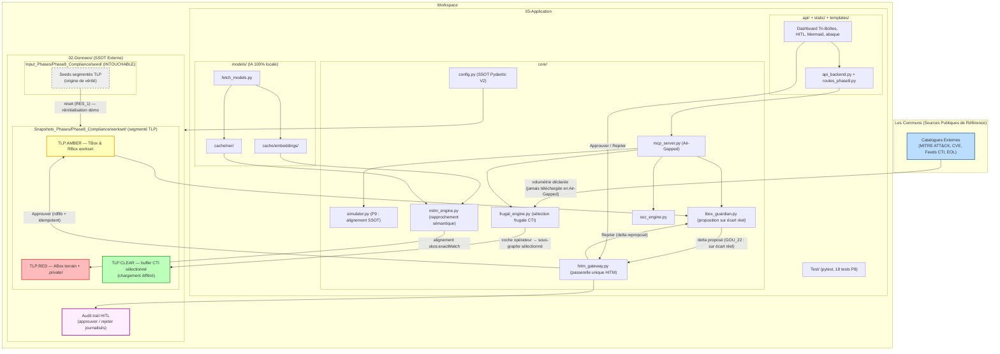

# Architecture DKG-CyberSec — Édition didactique post-Phase 8

> **Objet** : mise à jour didactique du document d'architecture pour refléter > l'état réel du démonstrateur à l'issue de la Phase 8 (Étape B recettée), > et présenter les deux **horizons** actés sans être implémentés
> (Gardien ABox §37, Sobriété §39).
>
> **Lecture guidée** : chaque section suit le même fil — *À quoi ça sert →> Concrètement dans le SI → Exigence tracée (EXG-\*)*. Les marqueurs TLP > (AMBER / RED / CLEAR) indiquent le cloisonnement de sécurité de chaque  zone (GOU_11). Les blocs « 🧭 Fil conducteur » résument la pédagogie de la > section.

---

## 1. Les Communs — Sources de connaissance publiques

- Dans le cas d'usage de ce développement qui est le SOC en cybersécurité, les communs sont constitués de bases externes recensant les menaces et les   vulnérabilités :
  - MITRE ATT&CK,
  - CVE,
  - Feeds CTI,
  - base EOL (fin de vie des composants logiciels).

- Ces sources sont identifiées dans un **catalogue maintenu par le SOC** :
  `external_sources_compliance_registry.json` (chemin SSOT résolu par   `core/config.py`).
  - *Rôle / Fonction* : flux de données de cybermenaces publics et de référence. Ils constituent la matière brute **externe** que l'agent capturera périodiquement de manière sélective — **jamais en direct en
    mode Air-Gapped** : le catalogue déclare la volumétrie disponible (« 0 chargé / X déclarés »), et seules les coches de l'opérateur déclenchent une consultation (EXG-MET-P8-DEM_2).

>[!🧭 **Fil conducteur** : le DKG ne télécharge pas le monde. Il sait ce qui existe (catalogue), et ne charge que ce que l'humain décide de consulter — c'est la première brique de la thèse de sobriété.]

---

## 2. Le Socle de Données (`02-Donnees/`)

L'architecture post-P8 introduit le modèle **Seed / Workset / Buffer**, qui remplace la lecture historique « Master unique » (EXG-MET-P8-RES_1) :

- **`Input_Phases/Phase8_Compliance/seed/` — les SEEDS (intouchables)** :
  états de référence d'origine. **Jamais modifiés par le démonstrateur** ;
  seule la réinitialisation (bouton *Réinitialiser la démo*) les relit pour   restaurer le working set.

- **`Snapshots_Phases/Phase8_Compliance/workset/` — le WORKING SET (segmenté TLP)** :
  la copie de travail dans laquelle tout le raisonnement et **toutes les
  écritures approuvées** (deltas TBox fusionnés via HITL) s'effectuent :
  - **TLP:AMBER** — TBox & RBox de référence du workset     (`DKG_TBox_Master.ttl`, règles de raisonnement) ;
  - **TLP:RED** — instances ABox du terrain (foyer résidentiel, scan     local hôte), données `.private/` hors Git (EXG-MET-P8-DEM_4c) ;
  - **TLP:CLEAR** — CTI externe filtré, conservée dans le fichier tampon dédié `selected_cti_clear_buffer.ttl` (chargement différé : rien n'est     chargé au départ, le volet se remplit à la volée selon les coches).

- **`Raw Data Interne`** : fichiers bruts, logs et rapports internes nécessitant une vectorisation ou un découpage par tranches pour alimenter le graphe (ex. bulletin brut replié dans le dashboard, DEM_4d).

- **Audit trail HITL** : `workset hitl_validation_audit.log` — journalisation de **chaque** décision humaine, approbation comme rejet (DEM_5).

>[!🧭 **Fil conducteur** : trois âges pour la donnée — le seed (la vérité d'origine), le workset (l'atelier où l'on raisonne), le buffer (la rampe de chargement frugal). Aucun moteur n'écrit dans le passé ; l'humain décide, le système journalise.]

---

## 3. Le Cœur Applicatif et les Agents (`03-Application/core/`)

- **`config.py` (SSOT Pydantic V2)** : source unique de vérité ; centralise la configuration et résout dynamiquement tous les chemins vers `02-Donnees` (GOU_5 : un seul exemplaire de chaque livrable).

- **`mcp_server.py` (Serveur MCP Central)** : point d'entrée standardisé (Model Context Protocol) en mode *Air-Gapped*, exposant moteurs et outils
  aux agents IA.

- **`hitm_gateway.py` (Passerelle HITM — capacité centrale de la Phase 8)** : entrée unique (API + CLI, EXG-MET-P8-DEM_6) du contrôle humain. Deux
  décisions souveraines possibles : **Approuver & Fusionner** (validation rdflib préalable, fusion idempotente — jamais de doublon) ou **Rejeter** (le delta sera reproposé tant que l'écart persiste : boucle assumée). 
  Chaque décision est journalisée dans l'audit trail (DEM_5). **Aucune écriture ontologique hors de cette passerelle** (DEM_3).

- **`tbox_guardian.py` (Agent Gardien TBox)** : supervise l'ingestion des deltas externes, vérifie la conformité conceptuelle (vocabulaire déclaré, EXG-FWK-P1-GOU_22) et prépare les propositions d'enrichissement. En Phase 8, le Gardien ne propose un delta **que sur écart réel** détecté entre vocabulaire utilisé et vocabulaire déclaré.

- **`frugal_engine.py` (Filtrage Frugal CTI)** : premier niveau de filtrage en amont sur les gros catalogues externes pour ne capturer que les deltas   à haute densité sémantique. En P8 : sélection du sous-graphe local TLP:CLEAR selon les sources cochées (lazy loading).

- **`mitm_engine.py` (Cœur de Rapprochement Sémantique)** : moteur central de rapprochement s'appuyant sur les modèles d'embeddings et de similarité
  pour établir les correspondances (`skos:exactMatch`).

- **`soc_engine.py` (Orchestrateur SOC)** : pilote les audits globaux, les validations de contraintes (SHACL) et la production des rapports.

- **`simulator.py` (DKGSimulator)** : moteur de simulation de charge et de montée en échelle (RSS réel via psutil). *À aligner en P9 sur les chemins
  SSOT de la Phase 8* + profils réalistes par persona PME/ETI (cf. Horizon 2).

> [!🧭 **Fil conducteur** : le Gardien *propose*, l'humain *décide* via la passerelle, le DKG *raisonne*. La passerelle HITM n'est pas un gadget ergonomique : c'est le seul point d'écriture du graphe, et son journal est la mémoire des décisions.]

---

## 4. Le Socle d'Intelligence Artificielle (`03-Application/models/`)

- **`fetch_models.py`** : script utilitaire d'approvisionnement téléchargeant et vérifiant l'intégrité des modèles en mode hors-ligne (*Air-Gapped*).
- **`cache/embeddings/`** : modèle vectoriel local (ex. `sentence-transformers`)pour le calcul de similarité cosinus.
- **`cache/ner/`** : modèles de Reconnaissance d'Entités Nommées (ex. `GLiNER`) pour structurer les données textuelles non structurées.

>[! 🧭 **Fil conducteur** : tous les modèles sont **locaux**. L'IA assiste la détection et le rapprochement ; elle ne décide jamais (garde-fou acté —> cf. Horizon 1).]

---

## 5. La Couche d'Accès et de Test (`03-Application/api/`, `static/`, `templates/`, `Test/`)

- **`api_backend.py` & `compliance_api_extension.py`** : couche FastAPI exposant   les services du backend de manière contrôlée.

- **`api/routes_phase8.py` (Routeur Phase 8)** : endpoints du démonstrateur —
  `GET /tbox` (TBox affichée dès l'ouverture, nettoyage *affichage* uniquement),
  `GET /rbox`, `POST /cti/select` (lazy + persistance du buffer CLEAR),
  `POST /audit` (bilan calculé par raisonnement local rdflib/SPARQL, zéro regex sur les `.ttl` — EXG-FWK-P8-AGE_1), `POST /tbox/merge` & `/tbox/reject`
  (via passerelle HITM), `POST /reset` (restauration du workset depuis les seeds — RES_1), `GET /frugality` (abaque Green-Dev, AGE_2), vues Mermaid
  `/tbox/graph`, `/abox/graph`, `/superposition/graph` (DEM_4b, avec marquage 
  ⚠️ des liens au vocabulaire non déclaré en TBox).

- **`static/` + `templates/index.html` (Dashboard Opérateur)** — la réalité remplace l'ancien `frontend_js/` :
  - **Tri-Boîtes** TLP:AMBER / TLP:RED / TLP:CLEAR à bordures colorées  (isolation visuelle, GOU_11) ;
  - badge **Air-Gapped** (« 0 requête » par défaut, DEM_2) ;
  - **carte Agent Gardien HITL** avec boutons *Approuver & Fusionner* / *Rejeter* et conséquences en langage clair (DEM_4) ;
  - bandeau **didactique** pilotant la lecture, vues **Mermaid** locales (fichier `mermaid.min.js` embarqué, aucun CDN — GOU_13), vue
    **superposition par alerte** (chaîne rouge interne → vert CTI), **abaque Green-Dev**, **bulletin brut replié**, bouton  **Réinitialiser la démo** ;
  - style artisanal `style.css` (aucune dépendance CDN).

- **`Test/` (Suite Pytest)** : tests unitaires et d'intégration de la phase 1 à la phase 8 — 18 tests en Phase 8 (audit tri-boîtes, lazy CTI, idempotence
  du merge, rejet journalisé, reset, abaque, superposition, cohérence vocabulaire TBox/ABox…), traçant les exigences `EXG-*`.

>[!🧱 Chaque exigence est tracée dans la matrice de traçabilité Spec ↔ Design ↔ Implémentation (implémentation · test · section de conception), et le code  porte l'UID de l'exigence en commentaire au point d'application.]

---

## 6. Le Graph (vue d'ensemble post-Phase 8)



> [!🧭 **Ce que montre le graphe et que l'ancien ne montrait pas** : les seeds intouchables (RES_1), le workset comme unique zone d'écriture, la **boucle HITL bilatérale** (proposition → décision humaine → fusion *ou* rejet journalisé), le chargement CTI différé, la volumétrie déclarée sans téléchargement, et le principe « base saine d'abord » : le Gardien ne propose que sur écart réel de vocabulaire déclaré (GOU_22).]

---

## 7. Les Deux Horizons (actés, NON implémentés)

### Horizon 1 — Agent Gardien ABox & détection hybride (acté 11/10/2026)

Le constat de recette : le finding SMBv1 repose sur une liaison ABox↔CTI par **mot-clé** (`CONTAINS "smb"`), informelle — contrairement à Log4Shell (`skos:exactMatch` explicite). Architecture cible en trois actes :

1. **Détection** : mot-clé v0 (conservé, repli déterministe) puis modèle local v1 (rapprochement sémantique 1-8B, LoRA, 100 % local).
2. **Formalisation** : le Gardien ABox propose un **delta ABox** (composant + liens explicites, vocabulaire TBox déclaré uniquement) → HITL obligatoire.
3. **Raisonnement** : après approbation, le pass formel SPARQL **prime** ; le mot-clé ne s'applique qu'aux expositions sans composant rattaché.

Boucle vertueuse : l'audit trail accumule des paires `(littéral ABox, entité CTI, décision humaine)` = jeu d'entraînement du
fine-tuning. Le DKG devient un **système qui apprend sous gouvernance humaine**. Garde-fous : le modèle ne décide jamais ; toute proposition porte  sa preuve ; workset uniquement ; traçabilité des entités générées.

### Horizon 2 — Thèse de sobriété & abaque 4 niveaux (acté 12/10/2026, P9) 

Prouver qu'un SOC Assistant agentique à base de Knowledge Graph peut être **sobre** : démontrable sur un PC sans GPU, 16 Go RAM. Choix fondateur :
**standards W3C purs** (.ttl + rdflib/SPARQL), et **chiffrer** le moment où un store natif devient incontournable. Les 4 couches de l'abaque :

1. **Repos distants** — volumétrie *déclarée*, jamais téléchargée en Air-Gapped ;
2. **Data fichiers locale** — segmentation socle / workset / cache ; 
3. **Data en RAM** — `ram_peak` estimé (≈ 1-2 Ko/triplet), RSS réel via le simulateur ; devra inclure l'empreinte des modèles IA locaux ;
4. **Distribution** (SOC_2/3) — extrapolation, seuil 16 Go, fédération standard via SPARQL `SERVICE`.

Livrable décision : benchmark **rdflib vs Oxigraph vs (option) Neo4j** à volumétrie croissante, pour une conclusion chiffrée et non dogmatique sur  les limites du standard pur.

> Ces deux horizons sont décrits en détail dans le canvas de recette P8 (§37 et §39) et dans la Base de Connaissance du projet ; à intégrer à la prochaine revue de Roadmap. **Rien n'est implémenté** avant la fin de la recette Étape B.

---

## 8. LLM version (bloc TSV de référence, post-P8)

```tsv
[CONTEXT: DKG-CyberSec Phase 8 recettée - Sovereign Air-Gapped MCP Multi-Agent Architecture]
- ROOT & SSOT: /Workspace with '02-Donnees/' (SSOT Externe) and '03-Application/core/config.py' (SSOT Pydantic V2, GOU_5).
- DATA LIFECYCLE (RES_1): seeds segmentés TLP under Input_Phases/Phase8_Compliance/seed/ (NEVER modified); working set under Snapshots_Phases/Phase8_Compliance/workset/ (TLP-segmented, sole writable zone); CTI buffer selected_cti_clear_buffer.ttl (lazy loading, persisted per selection).
- WORKSET TLP SEGMENTATION: TLP:AMBER (TBox/RBox reference), TLP:RED (ABox terrain, .private/ out of Git, DEM_4c), TLP:CLEAR (selected local CTI subset).
- INPUT SOURCES: external_sources_compliance_registry.json (volumétrie déclarée, jamais téléchargée en Air-Gapped, DEM_2).
- CORE ENGINES & MCP AGENTS: mcp_server.py (Air-Gapped registry); hitm_gateway.py (unique HITL entry, API+CLI parity DEM_6, idempotent merge, reject, audit trail DEM_5); tbox_guardian.py (proposal on real vocabulary gap only, GOU_22); frugal_engine.py (local-first subset selection); mitm_engine.py (semantic matching, skos:exactMatch); soc_engine.py; simulator.py (P9: SSOT alignment + PME/ETI personas).
- OFFLINE AI LAYER (03-Application/models/cache/): local sentence-transformers & GLiNER via fetch_models.py. Models never decide.
- ACCESS LAYER & DEMO UI: api/routes_phase8.py (audit, cti/select lazy, tbox/merge + reject via gateway, reset, /frugality abaque AGE_2, tbox/abox/superposition Mermaid graphs DEM_4b); templates/index.html + static/app.js + style.css (Tri-Boîtes TLP-bordered, Air-Gapped badge, HITL Gardien card approve/reject with plain-language consequences, didactic banner, local mermaid.min.js - no CDN GOU_13, Green-Dev abaque, superposition per-alert red-to-green, bulletin details, reset button).
- TESTING: 18 pytest tests incl. DEM_1 (tri-boîtes audit), DEM_2 (air-gapped lazy CTI), DEM_3 (HITL idempotent merge + reject), DEM_5 (audit log), RES_1 (reset), AGE_1 (local SPARQL, no regex on .ttl), AGE_2 (frugality), GOU_22 (TBox/ABox vocabulary coherence).
- TRACEABILITY: EXG-* UIDs in code comments + spec/design/impl matrix.
- HORIZONS (NOT IMPLEMENTED, actés 11-12/10/2026): (1) Gardien ABox hybrid detection - keyword v0 fallback, local model v1 detection, HITL ABox delta formalization, formal pass primes over keyword; audit trail as training set. (2) Sobriété thesis P9 - 4-layer abaque (declared remote / local files / RAM estimate incl. AI models / distribution), benchmark rdflib vs Oxigraph vs Neo4j, 16 Go threshold.
- GOAL: Sovereign, Air-Gapped, Green-by-Design, human-validated semantic security graph management - a system that learns under human governance.
```