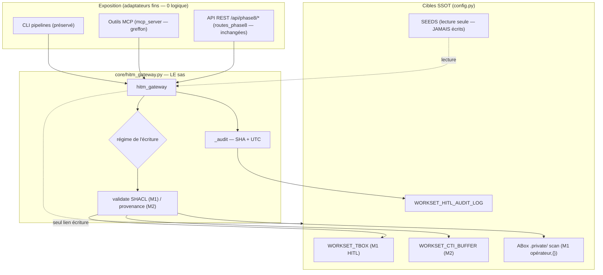

# Design C1 — hitm_gateway (option A2) — P9, 23/11/2026

> Étape bornée DESIGN (pas de code applicatif dans ce step). Source : lecture de
> `core/hitm_gateway.py` (rév. du 23/11, 149 l.) et `api/routes_phase8.py` (189 l.).
> EXG portées : GTW_1 (passerelle unifiée API+MCP, Golden Path), GTW_2 (régimes
> d'écriture). Loi de séparation : core/ n'importe jamais api/ ni fastapi.

## 1. Relevé de l'existant (le design part de ce qui est vivant)

| Élément existant | Verdict | Commentaire |
|---|---|---|
| `approve_and_merge / reject / reset_demo` dans core | ✔ conforme A2 | la logique a déjà migré ; routes = adaptateur fin (0 logique) |
| `_audit()` : UTC + SHA-256 tronqué + append | ✔ DEM_5 | format à figer tel quel (preuve EXG réponses |
| Fusion idempotente (détection sujets dkg: déjà déclarés, insensible owl: préfixe/URI) | ✔ DEM_3/GOU_5 | conservée à l'identique |
| Cible d'écriture : WORKING SET uniquement (jamais Master ni seeds) | ✔ RES_1 | invariant à verrouiller par test |
| CLI `request_human_validation()` | ✔ préservé | pipelines P3-P8 ne touchent pas |
| `validate_delta()` : parse rdflib | ⚠ partiel | GOU_22 (parsable) OK, mais **pas de validation SHACL** → GTW_2 exige M1 « SHACL-validée » : c'est LE greffon principal |
| Écritures CTI buffer (`build_cti_buffer`) et ABox scan (`.private/`, `agent_local_host_abox`) | ⚠ hors passerelle | deux voies d'écriture contournent le sas → à faire entrer dans les régimes M2/M1 (greffon n°2) |
| Exposition MCP gateway | ✗ absente | mcp_server expose déjà `run_tbox_guardian_pipeline` ; pas d'outils hitm → greffon n°3 |
| Docstring d'en-tête | ⚠ à mettre au format A4 | `"""GATEWAY — sas HITL & régimes d'écriture — recette/EXG"""` |

## 2. Architecture cible (une seule écriture, deux expositions)


(Équilibre subgraph/end vérifié : 3/3.)

## 3. Contrats figés

### 3.1 Fonctions core (signature publique inchangée + greffons)

```python
# existant — conservé à l'identique :
request_human_validation(delta_path) -> bool          # CLI
approve_and_merge(delta_ttl: str) -> dict             # {status, message}
reject(delta_ttl: str) -> dict
reset_demo() -> dict
ensure_workset_initialized() -> None
validate_delta(delta_ttl: str) -> bool

# greffons (design, à implémenter dans l'étape bornée impl) :
validate_delta_shacl(delta_ttl: str) -> tuple[bool, str]
    # parse PUIS pySHACL sur (WORKSET_TBOX + delta) vs SHACL via SSOT config
    # retourne (ok, violations_truncated) — réutilisé par approve_and_merge
record_write(regime: str, action: str, payload: str, target: Path) -> None
    # M2/scan : les modules (cti_intake, scan_engine) délèguent la
    # journalisation de leur écriture au sas — l'écriture reste locale au
    # module propriétaire (une seule écriture), le sas tient l'AUDIT (une
    # seule preuve). Pas de funnel d'écriture physique : loi d'orthogonalité.
```

Décision de design (à arbitrer d'un mot si discord) : le sas **n'absorbe pas
physiquement** les écritures de cti_intake/scan_engine (ce serait un funnel
monolithique, anti-5S) — il absorbe leur **traçabilité** : chaque écriture
M1/M2 appelle `record_write`, l'audit log devient la preuve unique des régimes
(aujourd'hui seul le scan s'y journalise, en dur : `SCAN_APPROVE`). GTW_2 est
satisfaite par « chaque écriture est déclarée PASSERELLE + régime », pas par
« tout le code écrit dans la passerelle ».

### 3.2 API REST : rien ne bouge (stabilité du démonstrateur)

`POST /tbox/merge`, `POST /tbox/reject`, `POST /reset`, `POST /scan` :
contrats Pydantic frozen inchangés (`MergeTBoxRequest`, etc. — restent dans
`api/` = contrat HTTP, pas dans core/ : loi de séparation).

### 3.3 Nouveaux outils MCP (greffon, dans mcp_server — registre maison)

| Outil | Délègue à | Réponse |
|---|---|---|
| `hitm_merge_delta` | `approve_and_merge` | `{status, message}` (421 implicite : status REJECTED) |
| `hitm_reject_delta` | `reject` | idem |
| `hitm_reset_workset` | `reset_demo` | idem |
| `hitm_audit_tail` (lecture) | lecture du log SSOT | 20 dernières lignes |

Import direct `from core.hitm_gateway import ...` — **jamais via api/** (couple
inverse interdit ; corrige au passage pattern actuel de mcp_server qui importe
`run_phase8_audit` de api.routes_phase8 → à tracer pour P11, pas C1).

## 4. Régimes d'écriture (GTW_2) — table de vérité cible

| Régime | Flux | Validation | Idempotence | Audit `_audit` | Cible |
|---|---|---|---|---|---|
| **M1 opérateur** | merge TBox delta | parse rdflib + **SHACL** (greffon) | déjà présente | `HITL_APPROVE` | WORKSET_TBOX |
| **M1 opérateur** | scan du poste (consentement clic) | pipeline scan (inchangé) | n/a | `SCAN_APPROVE` (déjà en place) | `.private/` ABox |
| **M2 sources** | cti buffer | catalogues TLP:CLEAR, provenance | buffer cumulatif | nouveau `CTI_INGEST` via `record_write` | WORKSET_CTI_BUFFER |
| **HITL boucle** | merge liens implicites ( Gardien TBox ) | = M1 TBox | déjà présente | `HITL_APPROVE` | WORKSET_TBOX |
| Reset | workset | seeds intacts | récopie | `HITL_RESET` | WORKSET_* |

## 5. Recettes figées (curl + résultat attendu) — à jouer après impl

```bash
# R1 — M1 accepté : curl -s -X POST localhost:8000/api/phase8/tbox/merge \
#   -H 'Content-Type: application/json' -d '{"delta_ttl":"dkg:ctrl a owl:DatatypeProperty ."}'
#   → {"status":"SUCCESS", ...} ; rejeu → {"status":"NOOP","message":"...idempotent..."}
# R2 — SHACL refusé : delta cassant une shape → {"status":"REJECTED","message":"...violation(s) SHACL..."} (422)
# R3 — unparsable : '{' → REJECTED (parse rdflib) (422)
# R4 — rejet opérateur : POST /tbox/reject → {"status":"REJECTED", ...} + ligne HITL_REJECT dans le log
# R5 — reset : POST /reset → SUCCESS + seeds intacts (sha256 avant/après identiques)
# R6 — audit : grep HITL_APPROVE log → lignes [UTC] ... delta_sha256=12 hex
# R7 — MCP : appel des 4 outils via le registre (test_mcp_server étendu)
# R8 — CLI inchangé : HITM_AUTO_APPROVE=1 pipeline P3 → validation true
# NonReg : 73 passed diff nul (les nouveaux tests C1 s'AJOUTENT : 73+N)
```

## 6. Plan d'implémentation (une étape bornée, une session)

1. `validate_delta_shacl` + branchement dans `approve_and_merge` (REJECT avant
   toute écriture si violations) + SSOT : réutiliser `SHACL_MASTER_PATH` de
   config.py (inventaire : rien de neuf à déclarer si le chemin existe déjà —
   à confirmer par grep config au début de l'impl) ;
2. `record_write` + appel côté `cti_intake` (M2) — scan_engine journalise déjà
   en dur : basculer son écriture d'audit sur le sas (une seule preuve) ;
3. 4 outils MCP + tests dédiés (extension de test_mcp_server, les EXistentants
   en convention `test_*_exg_*`) ;
4. docstrings A4 des fichiers touchés ;
5. recettes R1→R8 + NonReg 73 → commit.

**Hors périmètre C1 (tracé)** : répartition 2 apps FastAPI & import
mcp_server→api (P11) ; TBox exposition/M1 déclarations parc (structuration P10 —
le sas les accepte en M1 dès maintenant, forme figée en P10) ; GOU_7 (validation
aux frontières renforcée globally).

## 7. Critères d'acceptation (mapping EXG)

- **GTW_1 ✔ si** : Golden Path rejoué via API **et** MCP (R1-R7), CLI intact (R8),
  routes inchangées (contrat HTTP stable), core/ n'importe jamais api/ (grep = preuve) ;
- **GTW_2 ✔ si** : table §4 tenue (SHACL sur M1 TBox, régimes déclarés, audit
  unique au sas), aucune écriture non journalisée dans le workset/`.private/`
  (grep des fonctions d'écriture = preuve de vie).
