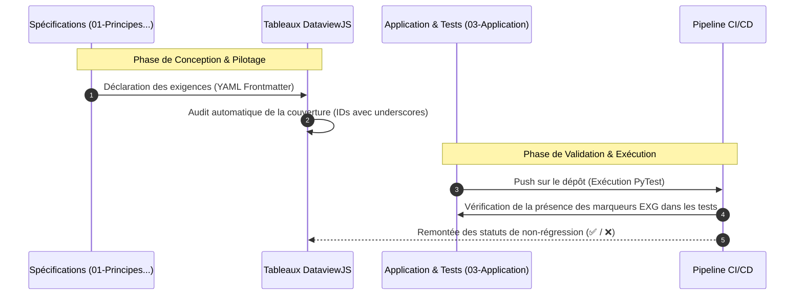

Ce répertoire centralise les spécifications système, le registre des exigences et les scripts de gouvernance du projet **DKG-CyberSec**. L'approche adoptée est **Spec-Driven**, étendue au **cycle en V**, permettant de lier de manière bi-directionnelle les besoins fonctionnels, l'architecture, le design technique et la validation automatisée par les tests.

## 0. Structure et Arborescence des Dossiers

Conformément à la gouvernance du projet, les spécifications sont réparties dans trois sous-répertoires stricts :

- **`./TRANSVERSAL/`** : Destiné à recevoir les spécifications du framework applicables indépendamment du cas d'usage (socles, TBox, SHACL, règlements).
    
- **`./USECASE_METIER/`** : Destiné à recueillir la description fonctionnelle du cas d'usage (ex: Cybersécurité, SOC, CTI).
    
- **`./USECASE_TECHNIQUE/`** : Destiné à recevoir les aspects techniques du design, les APIs et les choix d'implémentation des agents.
    

> [!NOTE]
> 
> Chaque spécification doit obligatoirement respecter le template défini dans `/00-Projet/Templates/` et comporter `type: spec` dans son frontmatter YAML.

## 1. Cartographie des Domaines Officiels

Chaque exigence est rattachée à un **Domaine** normé permettant de ségréger le fonctionnel pur de l'architecture technique, facilitant le partage contextuel avec les LLMs et l'isolation des tests :

|**Code Domaine**|**Nom Complet**|**Description & Périmètre**|**Exemples de Périmètre**|
|---|---|---|---|
|**`CT`**|Cyber Threat Intelligence|Modélisation des données CTI externes, vulnérabilités et menaces.|CVE, CWE, CAPEC, CISA KEV, scores CVSS.|
|**`HW`**|Hardware & Infrastructures|Contraintes matérielles, d'exécution locale et de performance système.|Limites RAM 16 Go, absence de GPU, mode Air-Gapped.|
|**`IN`**|Inférence & Graph Analytics|Règles de raisonnement sémantique, déduction de liens et calculs de propagation.|Détection de cascade de risque, classe `HighRiskAsset`.|
|**`OR`**|Organisation & Processus|Gouvernance du projet, méthodologie Spec-Driven et standards de livraison.|Traçabilité des phases, conventions Git, parité Master/Snapshot.|
|**`QU`**|Qualité & Conformité|Règles de validation de la qualité des données et métriques d'intégrité.|Contrôles pySHACL, fermetures CWA, 0 violation SHACL.|
|**`SE`**|Sécurité & Isolation|Étanchéité, marquage TLP et politiques de contrôle d'accès aux graphes.|Ségrégation TLP:CLEAR vs TLP:RED, isolation des snapshots.|
|**`SH`**|SHACL Shapes|Modélisation abstraite et concrète des formes de validation de structures.|`sh:NodeShape`, `sh:PropertyShape`, méta-shapes.|
|**`TB`**|TBox & Ontologies Master|Définition formelle des classes, propriétés, relations inverses et SKOS.|Classes OWL, `rdfs:domain`/`range`, `owl:inverseOf`, SKOS.|
|**`TEC`**|Technique & Core Framework|Socle applicatif, gestion des types de données, immutabilité et bas niveau.|Schemas Pydantic V2, horodatage UTC, immutabilité payloads.|
|**`MET`**|Méthodologie & Agents|Standards d'ingénierie et comportement des agents assistants.|Protocoles d'assistance au développement.|

## 2. Structure Normalisée d'une Exigence (YAML Frontmatter)

Dans chaque note de spécification, les exigences sont déclarées sous forme de bloc YAML structuré selon les clés obligatoires suivantes :
```yaml
exigences:
  - id: "EXG-FWK-P1-GOU_1"
    domaine: "OR"
    core: true
    titre: "Intitulé court de l'exigence"
    critere: "Description formelle et vérifiable du comportement attendu."
    test: "PyTest associé"
```

- **`id`** : Identifiant unique respectant la syntaxe normalisée (ex: supportant les tirets et underscores via `EXG-[\w-]+`).
    
- **`core`** : Booléen (`true` pour le périmètre Core soumis à la non-régression, `false` pour du spécifique/transitoire).
    

## 3. Le Cycle en V et le Rebouclage des Tests

Le flux de traçabilité garantit que chaque exigence rédigée possède un équivalent dans les scripts de test Python (`03-Application/Test/`) :

Extrait de code



## 4. Tutoriels et Guides Opérationnels pour les Contribuants

### Tuto 1 : Créer ou mettre à jour une Spécification

1. Créez ou modifiez un fichier markdown dans le sous-dossier adéquat (`TRANSVERSAL`, `USECASE_METIER` ou `USECASE_TECHNIQUE`).
    
2. Assurez-vous d'inclure dans le tableau Markdown de la page les colonnes standardisées (ID, Domaine, Core/Non-Core, Intitulé, Critère, Test).
    
3. Utilisez le script **Templater** de votre coffre Obsidian pour générer ou mettre à jour automatiquement l'en-tête YAML `exigences:` à partir de votre tableau.
    

### Tuto 2 : Rattacher un Test Python à une Exigence

Pour qu'un script de test (`.py`) soit correctement intercepté par les tableaux de pilotage Obsidian (sans remonter en tant qu'orphelin) :

- Inscrivez l'identifiant exact de l'exigence (ex: `EXG-FWK-P1-GOU_1`) dans la **docstring** de la fonction de test concernée :
    
```python
def test_ma_fonction():
    """Exigence: EXG-FWK-P1-GOU_1 - Description du test associé."""
    # Logique de test...
       assert True
```
    

### Tuto 3: Non regression

Le marqueur manuel (règle officielle) 

```python
@pytest.mark.non_regression
def test_ma_fonction():
    """Exigence: EXG-FWK-P1-GOU_1 - Description du test associé."""
    # Logique de test...
       assert True
```


les 3 règles d'application (docstring `Exigence:` obligatoire sur tout test marqué, marquage d'un test non recetté interdit, retrait du marqueur = décision en revue), et la CI inchangée (`pytest -m non_regression` + `--strict-markers` + déclaration dans `pytest.ini`).

### Tuto 4 : Vérifier la couverture locale des tests

Ouvrez le fichier de pilotage **`01-1_Atelier_Gestion_Exigences_Tests.md`** dans Obsidian :

- Le tableau de **Couverture des exigences** met en correspondance directe chaque exigence avec son fichier de test et son statut de non-régression (`NonReg`).
    
- La section **Tests Orphelins** vous signale immédiatement toute fonction de test qui ne référence pas explicitement un identifiant valide du coffre.