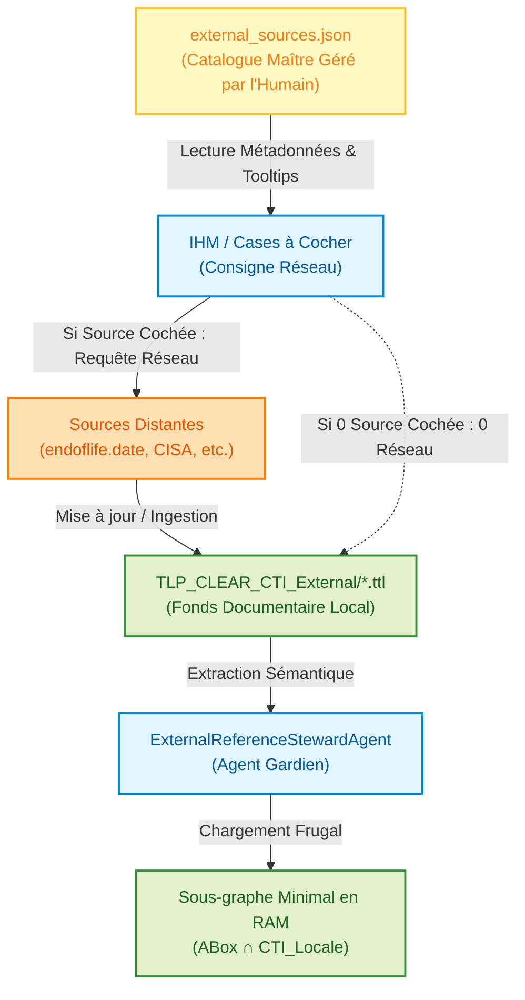

# 📜 Agent Gardien des Références Externes (External Reference Steward)

## 📖 1. Résumé Exécutif & Glossaire

### 1.1 Objectif
Cette spécification définit le socle générique de l'**Agent Gardien des Références Externes** (`ExternalReferenceStewardAgent`). Son rôle est de superviser, filtrer et valider l'intégration des référentiels normatifs mondiaux et des flux publics externes (ex: RGPD, DPV, CTI) en respectant strictement le manifeste **Green-by-Design** (postes 16 Go RAM, Air-Gapped strict).

### 1.2 Glossaire Métier & Technique
| Acronyme / Concept | Définition | Contexte DKG |
| :--- | :--- | :--- |
| **DKG** | Dynamic Knowledge Graph | Graphe de connaissances dynamique du projet. |
| **DPV** | Data Privacy Vocabulary | Vocabulaire W3C de référence pour la protection des données et la conformité. |
| **CWA** | Closed World Assumption | Hypothèse du monde clos utilisée pour la validation SHACL rigoureuse. |
| **TLP** | Traffic Light Protocol | Protocole de ségrégation des données (`CLEAR`, `AMBER`, `RED`). |

## 🏗️ 2. Périmètre & Rôle de la Spécification
- **Positionnement dans l'Architecture** : Socle Transversal (`TRANSVERSAL/`) réutilisable pour toutes les phases nécessitant l'ingestion de sources publiques distantes (Phase 8 RGPD, Vagues futures GraphRAG).
- **Gouvernance & Validation** : Validé par l'Architecte Sémantique et IA SOC.

## 📐 3. Spécifications Formelles & Règles

### 3.1 Axiomes, Structures RDF ou Scénario Métier

### 3.1 Axiomes, Structures RDF ou Scénario Métier

- **Découplage Consigne Réseau vs Raisonnement Local (Air-Gapped Native) :**
  - **IHM / Cases à cocher (Consigne Réseau) :** Elles servent exclusivement d'instruction d'interrogation distante pour l'Agent Gardien (rafraîchissement ou enrichissement des fichiers `.ttl` locaux dans `TLP_CLEAR_CTI_External/`).
  - **Fonctionnement Air-Gapped (0 source cochée / Offline) :** Si aucune source n'est cochée (ou en l'absence de réseau), **0 requête web n'est émise**. L'Agent s'appuie intégralement sur les triplets déjà présents dans les fichiers `.ttl` locaux sur disque.
  
- **Principe du Subset Minimal (RAM Frugale) :** Interdiction stricte de charger l'intégralité d'une ontologie ou base CTI/EOL externe lourde en mémoire. L'agent extrait uniquement le sous-graphe sémantique minimal issu du croisement entre l'ABox et le fonds `.ttl` local ($\text{ABox} \cap \text{CTI}_{\text{locale}}$).
    
- **Isolation TLP :** Le référentiel public supervisé et généré par l'agent est obligatoirement étiqueté en **`TLP:CLEAR`**. Aucune fuite vers les graphes internes (`TLP:RED` / `AMBER`) n'est tolérée.
   

### 3.2 Directives d'Implémentation Code & Scripts

- Utilisation exclusive des objets et chemins centralisés dans `03-Application/config.py` (conformité SSOT `EXG-OR-05`).
    
- Modélisation et validation des configurations par des objets Pydantic V2 avec immutabilité (`frozen=True`, `EXG-TE-01`).
    

## 📊 4. Matrice des Exigences & Critères d'Acceptation (EXG-)

| **Identifiant**  | **UID**            | **Domaine** | **Core/Non-Core** | **Intitulé de l'Exigence**            | **Description & Critères d'Acceptation**                                                                                                                                                                                                                                            | **Mode de Test / Asset**              |
| ---------------- | ------------------ | ----------- | ----------------- | ------------------------------------- | ----------------------------------------------------------------------------------------------------------------------------------------------------------------------------------------------------------------------------------------------------------------------------------- | ------------------------------------- |
| **EXG-P8-01**    | `EXG-FWK-P8-age_1` | `SE`        | Core              | Traçabilité & Filtrage Frugal Externe | **1.** Conservation du catalogue source (`external_sources.json`). **2.** Si 0 source sélectionnée : **0 requête réseau émise**. **3.** Exploitation du fonds `.ttl` local existant et extraction RAM du sous-graphe minimal ($\text{ABox} \cap \text{CTI}_{\text{locale}}$). | Pytest / SPARQL / Assert Network Logs |
| **EXG-GREEN-01** | `EXG-FWK-P8-age_2` | `TEC`       | Core              | Sobriété et Local-First               | Exécution fluide en moins de 1s sur poste hôte standard 16 Go RAM Air-Gapped.                                                                                                                                                                                                       | Benchmark / Pytest                    |

## 🛡️ 5. Outillage, CI/CD & Traçabilité Pytest

- **Scripts de Génération / Exécution** : `03-Application/Phase8/compliance_steward_agent.py`
    
- **Suites de Tests Associées** : `03-Application/Test/test_phase8_compliance.py`
    
- **Critères d'Acceptation** : Validation syntaxique RDFlib, absence de violation sous pySHACL (`sh:Violation` = 0).
    
- **Artefacts Produits** : `02-Donnees/Master_Transversal/abox_compliance_standards_clear.ttl`

- **Catalogue maître :** `02-Donnees/Input_Phases/Phase8_Compliance/external_sources.json`
    
- **Répertoire TTL Local :** `02-Donnees/Master_Transversal/TLP_CLEAR_CTI_External/`
    
- **Route / Agent API :** `03-Application/api/routes_phase8.py`

## 📚 6. Documents Liés & Références

- **SPEC-SOCLE-01** : Socle TBox Master & Règles W3C.
    
- **SPEC-METIER-UC08** : Compliance & Preuve Réglementaire Frugale (RGPD).
- 