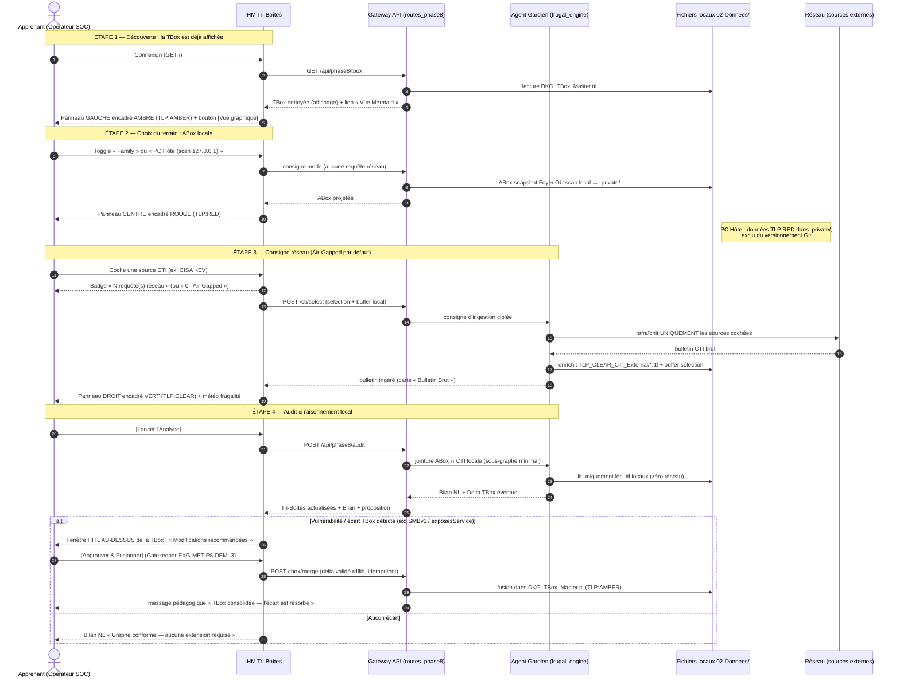
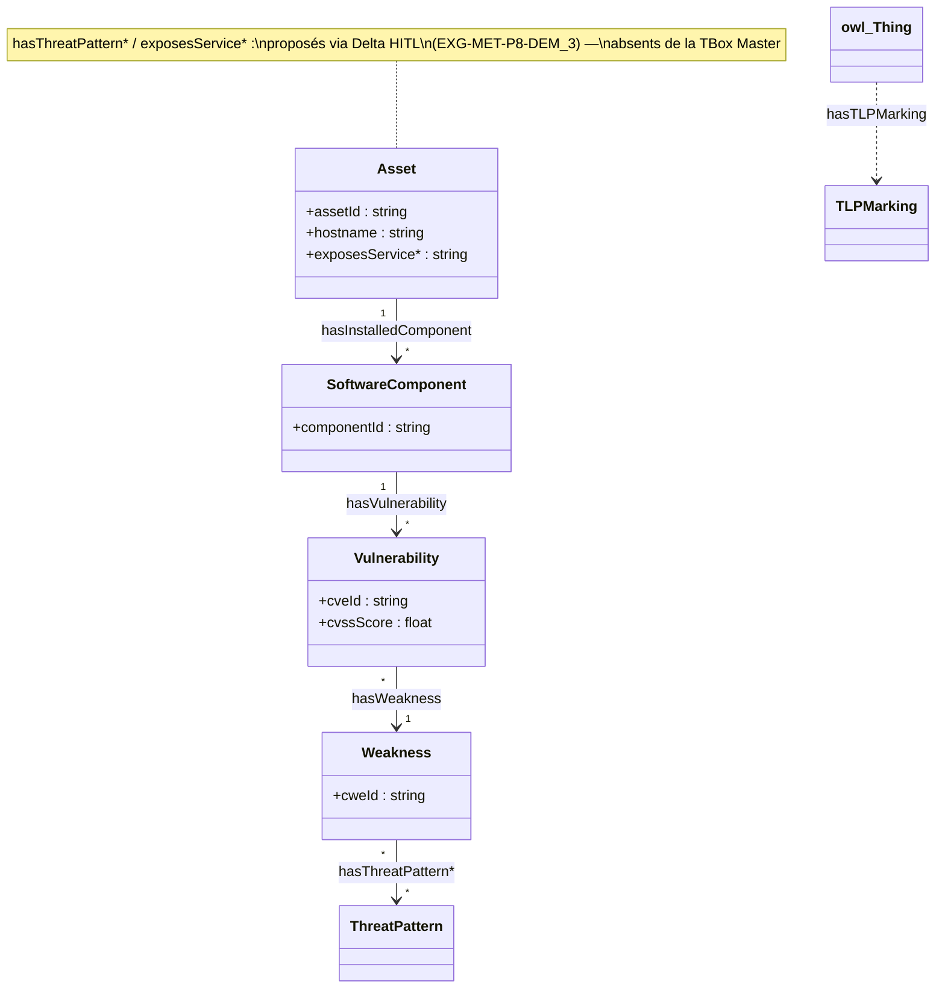

# 📜 Spécification d'IHM et Démonstrateur Phase 8
## 📖 1. Résumé Exécutif & Glossaire
	
### 1.1 Objectif
Cette spécification définit l'architecture d'intégration et l'IHM du **démonstrateur de la Phase 8**. Elle concrétise l'orchestration souveraine entre la **TBox Master**, l'**ABox de l'équipement** (Foyer ou Scan local `127.0.0.1`), et le **fonds CTI TLP:CLEAR local**. Elle introduit un modèle d'ingestion économe piloté par l'IHM et un mécanisme de validation humaine **HITL (Human-In-The-Loop)** pour l'extension de l'ontologie.
	
### 1.2 Glossaire Métier & Technique

| Acronyme / Concept | Définition              | Contexte DKG                                                           |
| :----------------- | :---------------------- | :--------------------------------------------------------------------- |
| **DKG**            | Dynamic Knowledge Graph | Graphe de connaissances dynamique du projet.                           |
| **HITL**           | Human-In-The-Loop       | Validation humaine obligatoire avant modification de la TBox.          |
| **EOL**            | End-of-Life             | Statut d'obsolescence matérielle ou logicielle (ex: `endoflife.date`). |
| **CWA**            | Closed World Assumption | Validation SHACL stricte sans hypothèse d'information manquante.       |
| **SSOT**           | Single Source of Truth  | Source de vérité unique portée par `03-Application/config.py`.         |
	
---
	
## 🏗️ 2. Périmètre & Rôle de la Spécification
- **Positionnement dans l'Architecture** : Spécification d'Application / Cas d'Usage Métier (`USECASE_METIER`) articulant les briques `SPC-FWK-P8-agent_gardien_references_externes_01`, `SPC-FWK-P1-GOUV_01` et `SPC-TEC-P08-green_development_framework_01`.
- **Gouvernance & Validation** : Validé par l'Architecte Ontologue, le Lead Dev IHM et l'Analyste SOC.
	
	```mermaid
	graph TD
	    classDef clear fill:#e2f0cb,stroke:#388e3c,stroke-width:2px,color:#1b5e20;
	    classDef process fill:#e1f5fe,stroke:#0288d1,stroke-width:2px,color:#01579b;
	    classDef registry fill:#fff9c4,stroke:#fbc02d,stroke-width:2px,color:#f57f17;
	
	    JSON["external_sources.json<br>(Index du Catalogue)"]:::registry
	    IHM["IHM Démonstrateur<br>(Toggle Mode & Cases à Cocher)"]:::process
	    Agent["Agent Gardien & Ingestion"]:::process
	    
	    TBox["1. TBox Master (.ttl)"]:::clear
	    ABox["2. ABox Instance (.ttl)"]:::clear
	    CTI["3. CTI TLP CLEAR Local (.ttl)"]:::clear
	    
	    RAM["Moteur d'Inférence RAM<br>(Sous-Graphe Minimal ABox ∩ CTI)"]:::process
	    UI_Bilan["Rendu UI : Bilan NL & Validation HITL"]:::clear
	
	    JSON -->|Lecture Tooltips & Sources| IHM
	    IHM -->|Consigne Réseau -Si Coché-| Agent
	    Agent -->|Mise à Jour / Ingestion| CTI
	    
	    TBox --> RAM
	    ABox --> RAM
	    CTI -->|Triplets Locaux Pertinents| RAM
	    
	    RAM --> UI_Bilan
	```
	
	
## 📐 3. Spécifications Formelles & Règles
### 3.1 Axiomes, Layout IHM & Scénario Métier
	
1. Disposition Visuelle IHM (Layout Tri-Boîtes TTL)
	L'interface présente dans sa partie supérieure trois zones côte à côte de gauche à droite permettant de visualiser directement le code Turtle RDF :
	
	- Boîte 1 (Gauche) — TBox (Ontologie Master) : Vocabulaire dkg: décrivant les classes et propriétés.
	- Boîte 2 (Centre) — ABox (Instances) : Équipements instanciés selon le mode choisi (Toggle : Snapshot Foyer ou Scan Local 127.0.0.1).
	- Boîte 3 (Droite) — Données Externes TLP CLEAR : Fonds documentaire CTI/EOL local chargé à partir de TLP_CLEAR_CTI_External/*.ttl.
	
2. Découplage Stricte Réseau vs Raisonnement Local (Air-Gapped First)
	
	- Cases à cocher IHM (Consigne Réseau) : Elles n'agissent que comme une consigne d'interrogation distante. Seules les sources cochées déclenchent des requêtes web par l'Agent Gardien pour mettre à jour les fichiers .ttl locaux.
	- Raisonnement sur la Base Locale : Le moteur s'appuie toujours sur les fichiers .ttl locaux déjà disponibles sur disque.
	
	- Règle Frugale (0 source cochée) :
			❌ Réseau : 0 requête réseau émise.
			🟢 Mémoire RAM : Seuls les triplets CTI locaux pertinents pour l'ABox active sont chargés en mémoire (ABox∩CTI locale).
	
3. Bilan Synthétique NL & Validation HITL (Gatekeeper)
	
	- Bilan Synthétique NL (Sous les 3 boîtes) : Tableau récapitulatif identifiant l'Équipement, le Composant/Service, le Statut EOL / Menace CTI, et le Niveau de Gravité Rehaussé.
	- Boucle HITL d'Extension TBox : Si une vulnérabilité ou obsolescence est détectée, l'Agent Gardien propose un Delta TTL TBox. L'extension n'est injectée dans la TBox Master qu'après action explicite de l'opérateur via [Approuver & Fusionner].
4. Layout
L'onglet **« Audit & Raisonnement »** s'articule en 3 colonnes principales et 2 bandeaux inférieurs :

```
+-----------------------------------------+------------------------------+------------------------------+
| [Bandeau Supérieur] Toggle              | Checkboxes CTI (Dynamiques)  | [Bouton Lancer l'Analyse]    |
| (Foyer/Hôte)                            | ...                          | [RESET DEMO]                 |
|                                         | ...                          |                              |
[+------------------------------------+---+------------------------------+------------------------------+
| COLONNE 1 (GAUCHE)                 | COLONNE 2 (CENTRE)                | COLONNE 3 (DROITE)           |
| Ontologie TBox & Agent Gardien     | Instance ABox (TLP:RED)           | Menaces & Frugalité          |
|                                    |                                   |                              |
| - Pre: TBox Transversale (.ttl)    | - Pre: Graph ABox (.ttl)          | - Pre: Graph CTI (.ttl)      |
| - Card: Delta Agent Gardien (HITM) |   (Bordure Rouge TLP:RED)         | - Footer: Métriques octets/  |
|   [Approuver] / [Rejeter]          |   Mise à jour directe au Toggle   |   taux de frugalité          |
+------------------------------------+-----------------------------------+------------------------------+
| [Carte Bilan] Bilan Synthétique en Langage Naturel & Diagnostic                                       |
+-------------------------------------------------------------------------------------------------------+
| [Carte Bulletin] Bulletin Brut Ingesté (Affiché si source CTI cochée)                                 |
+-------------------------------------------------------------------------------------------------------+
| [Graph mermaid]                                                                                       |
+-------------------------------------------------------------------------------------------------------+


```


### 3.2 Directives d'Implémentation Code & Scripts
	
- Centralisation des Chemins (config.py) : Utilisation des variables SSOT pour accéder au catalogue external_sources.json et au répertoire TLP_CLEAR_CTI_External/.
- Projections ABox Conformes : Les objets ABox générés par le scan local 127.0.0.1 ou le JSON Foyer doivent strictement respecter la structure dkg: déclarée dans la TBox Master (EXG-FWK-P1-GOU_22).


## 📊 4. Matrice des Exigences & Plan de Tests d'Intégration (EXG-)
Cette section regroupe l'ensemble des exigences vérifiées lors de la recette du démonstrateur : les **exigences héritées** des briques transversales et les **exigences propres** à l'IHM/intégration.
### 4.1 Exigences Propres au Démonstrateur (Nouvelles Exigences Métier & IHM)
	
| **UID**          | **ID**             | **Domaine** | **Intitulé**                                      | **Description & Critère d'Acceptation**                                                                                                                                                                                                                                                                                                                                                                                                                                                                                                                                                                                                                                              | **Mode de Test**                                                         |
| ---------------- | ------------------ | ----------- | ------------------------------------------------- | ------------------------------------------------------------------------------------------------------------------------------------------------------------------------------------------------------------------------------------------------------------------------------------------------------------------------------------------------------------------------------------------------------------------------------------------------------------------------------------------------------------------------------------------------------------------------------------------------------------------------------------------------------------------------------------ | ------------------------------------------------------------------------ |
| EXG-MET-P8-DEM_1 | `EXG-MET-P8-DEM_1` | `MET`       | Agencement Tri-Boîtes TTL & Bilan NL              | Visualisation IHM des 3 zones TTL côte à côte (TBox, ABox, CTI) et génération du bilan de risques/obsolescence sous les boîtes.                                                                                                                                                                                                                                                                                                                                                                                                                                                                                                                                                      | E2E Playwright / Pytest UI                                               |
| EXG-MET-P8-DEM_2 | `EXG-MET-P8-DEM_2` | `TEC`       | Consigne de Ciblage Réseau IHM                    | Les cases à cocher agissent comme consigne réseau. Si 0 case cochée : **0 requête HTTP émise** sur le réseau.                                                                                                                                                                                                                                                                                                                                                                                                                                                                                                                                                                        | Pytest Mock Network Logs                                                 |
| EXG-MET-P8-DEM_3 | `EXG-MET-P8-DEM_3` | `SE`        | Gatekeeper HITL pour Extension TBox               | Toute proposition de Delta TBox (obsolescence/CVE) reste en attente de la validation explicite `[Approuver & Fusionner]`.                                                                                                                                                                                                                                                                                                                                                                                                                                                                                                                                                            | Pytest / SPARQL Assert                                                   |
| EXG-MET-P8-DEM_4 | EXG-MET-P8-DEM_4   | `MET`       | Confort pédagogique & souveraineté de l'apprenant | (a) Un **message didactique** unique en tête de page explicite chaque  <br>étape (« ce qui s'est passé / à retenir ») et est mis à jour à chaque action  <br>(connexion, toggle, coche, analyse, approbation). (b) La TBox propose une  <br>**vue graphique dynamique** (diagramme de classes Mermaid) générée depuis le  <br>`.ttl` Master. (c) Le mode « PC Hôte » écrit toute donnée de scan dans  <br>`.private/` (DIR_PRIVATE_RED), **exclu du versionnement Git** (test :  <br>`".private" in .gitignore`). (d) La carte **Bulletin Brut** est repliée par  <br>défaut, dépliable en un clic. (e) Lisibilité : tout texte reste lisible sur  <br>fond sombre (contraste ≥ AA). | Pytest (message présent à chaque étape, endpoint /tbox/graph, gitignore) |

### 4.2 Exigences Héritées à Vérifier lors des Tests d'Intégration (Briques Parentes)

Ces exigences proviennent des spécifications transversales (`SPC-FWK-*`, `SPC-TEC-*`) et doivent être **re-validées end-to-end** au sein du démonstrateur :

| UID               | **Spec Source**        | **Domaine** | **Intitulé Hérité**               | **Condition de Succès dans le Démonstrateur**                                                                                             | **Type de Test**            |
| :---------------- | :--------------------- | :---------- | :-------------------------------- | :---------------------------------------------------------------------------------------------------------------------------------------- | :-------------------------- |
| EXG-FWK-P8-AGE_1  | `SPC-FWK-P8_Agent_...` | `SE`        | Ingestion Frugale & Base Locale   | L'agent raisonne sur les fichiers `.ttl` locaux existants (`TLP_CLEAR_CTI_External/*.ttl`) sans perte de données.                         | Integration Pytest / SPARQL |
| EXG-FWK-P8-AGE_2  | `SPC-FWK-P8_Agent_...` | `TEC`       | Sobriété & Performance (Green IT) | Extraction du sous-graphe minimal ($\text{ABox} \cap \text{CTI}_{\text{locale}}$) et calcul du bilan NL en **< 1 seconde** sur RAM 16 Go. | Benchmark / Performance     |
| EXG-FWK-P1-GOU_11 | `SPC-FWK-P1-GOUV_01`   | `SE`        | Marquage TLP Obligatoire          | Ingestion et affichage isolés des flux CTI étiquetés strictement en **`TLP:CLEAR`**.                                                      | Pytest RDFlib / SHACL       |
| EXG-FWK-P1-GOU_13 | `SPC-FWK-P1-GOUV_01`   | `SE`        | Air-Gapped & Modèles Locaux       | Le démonstrateur fonctionne de manière 100 % autonome sans accès Web lorsque le réseau est coupé.                                         | Isolation Test (Offline)    |
| EXG-FWK-P1-GOU_22 | `SPC-FWK-P1-GOUV_01`   | `QU`        | Vocabulaire *TBox First*          | L'ABox projetée (Mode Foyer ou Scan local `127.0.0.1`) utilise exclusivement les classes/propriétés `dkg:`.                               | Validation pySHACL          |
| EXG-FWK-P1-GOU_5  | `SPC-FWK-P1-GOUV_01`   | `OR`        | Architecture SSOT (`config.py`)   | L'IHM et l'Agent lisent le catalogue `external_sources.json` via les chemins centralisés de `config.py`.                                  | Audit Code / Pytest         |

## 🛡️ 5. Outillage, CI/CD & Traçabilité Pytest
- Scripts de Génération / Exécution :
		- API & Routes IHM : 03-Application/api/routes_phase8.py
		- Catalogue Maître JSON : 02-Donnees/Input_Phases/Phase8_Compliance/external_sources.json
		- Vivier CTI Local : 02-Donnees/Master_Transversal/TLP_CLEAR_CTI_External/*.ttl
- Suites de Tests Associées :
		- 03-Application/Test/test_phase8_demonstrator.py
		- 03-Application/Test/test_phase8_compliance.py
	
- Critères d'Acceptation :
		- Absence de requêtes HTTP lorsque le dictionnaire de toggles est vide ({}).
		- Conformité du sous-graphe extrait par rapport au profil pySHACL (sh:Violation = 0).
	
- Artefacts Produits :
		- Proposition Delta TBox : 02-Donnees/Master_Transversal/delta_tbox_proposed.ttl
	
## 📚 6. Documents Liés & Références
	
- SPC-FWK-P8-agent_gardien_references_externes_01 : Spécification Transversale de l'Agent Gardien des Références Externes.
- SPC-FWK-P1-GOUV_01 : Spécification de Gouvernance, Format RDF Turtle, Green IT & Matrice TLP.
- SPC-TEC-P08-green_development_framework_01 : Framework de Développement Frugal et FinOps Sémantique.
- SPC-MET-P07-assistant_soc_foyer_01 : Cartographie et Analyse d'Exposition Résidentielle (ABox).
	
	---

## 🤖 7. Context Anchor pour Assistant LLM (Prompt-Ready)

> **Instructions pour l'Humain / Développeur :**  
> Copier-coller l'intégralité du bloc ci-dessous dans l'amorce (System Prompt ou 1er message) d'une nouvelle session LLM pour itérer sur le code, les tests Pytest ou les refactorisations sans perte de contexte.

### 7.1 Matrice d'Invariants & Rules (TSV)
```tsv
UID	ID	DOMAIN	TYPE	RULE_SUMMARY	TEST_ASSERTION
EXG-MET-P8-DEM_1	EXG-MET-P8-DEM_1	MET	CORE	Layout Tri-Boîtes TTL (TBox, ABox, CTI) + Bilan NL	UI_Render_3_TTL_Zones == True
EXG-MET-P8-DEM_2	EXG-MET-P8-DEM_2	TEC	CORE	Toggle IHM = Consigne Réseau. Si 0 coche -> 0 HTTP req	HTTP_Requests_Count == 0 if selected_sources == []
EXG-MET-P8-DEM_3	EXG-MET-P8-DEM_3	SE	CORE	Gatekeeper HITL obligatoire pour merge Delta TBox	TBox_Master_Modified == True ONLY IF user_click == 'APPROVE'
EXG-FWK-P8-AGE_1	EXG-FWK-P8-age_1	SE	CORE	Raisonnement Local-First sur base TTL TLP:CLEAR	Load_SubGraph(ABox INTERSECT CTI_Local)
EXG-FWK-P1-GOU_22	EXG-FWK-P1-GOU_22	QU	CORE	Typage ABox First & respect strict vocabulaire dkg:	pySHACL_Violations_Count == 0

AGE_2 : `Bilan_Computation_Time < 1s` ;
GOU_11 : `CTI_Ingested_TLP == "CLEAR" ONLY`
GOU_13 : `Offline_Mode == True`
GOU_5 : `paths from config.py SSOT`).
```

### 7.2 Index des Dépendances & Specs Liées (Pointers TSV)

Extrait de code

```tsv
SPEC_REF	RELATION	TARGET_PATH	KEY_EXG_TO_FETCH
SPC-FWK-P8-agent_gardien_references_externes_01	PARENTE	01-Specs/SPC-FWK-P8_Agent_Gardien_RefExt_01.md	EXG-FWK-P8-AGE_1, EXG-FWK-P8-AGE_2
SPC-FWK-P1-GOUV_01	SOCLE	01-Specs/SPC-FWK-P1-GOUV_01.md	EXG-FWK-P1-GOU_5, EXG-FWK-P1-GOU_11, EXG-FWK-P1-GOU_22
SPC-TEC-P08-green_development_framework_01	METHODE	01-Specs/SPC-TEC-P08-green_dev_01.md	EXG-TEC-P08-GR_2
```

### 7.3 System Prompt d'Amorce pour le LLM (Template à copier)

Plaintext

```tsv
Tu es l'Expert-Lead DevSecOps et Ontologue du projet DKG-CyberSec.
Nous travaillons sur l'implémentation de la spec [SPC-MET-P8-demonstrateur_phase8_01].
Voici le contexte d'invariants formels et de dépendances que tu DOIS respecter à 100% :

[Coller ici les blocs 7.1 et 7.2]

Règles de travail pour cette session :
1. Chaque ligne de code ou de test Pytest produite doit citer l'UID de l'exigence qu'elle couvre (ex: `# Exécute EXG-MET-P8-DEM_2`).
2. Aucune modification de TBox Master ne doit être faite automatiquement (Gatekeeper HITL EXG-MET-P8-DEM_3).
3. Si une modification d'architecture touche une spec parente (ex: SPC-FWK-P8-agent_gardien...), alerte-moi immédiatement.
```

### 8. Sequence de l'apprenant




## 9. mermaid TBox



