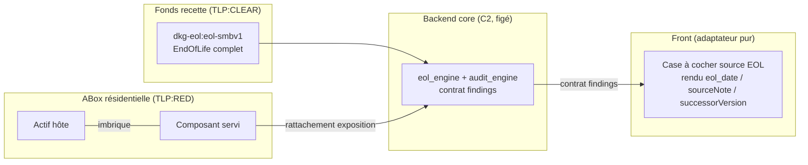

# 📜 Vague P10-EOL : Fond Structuré, Imbrication, Adaptateur Front

## 📖 1. Résumé Exécutif & Glossaire

### 1.1 Objectif
Cette spécification ouvre la vague EOL de la phase P10. Elle clôt les 3 enjeux restés hors périmètre à la fermeture de l'étape 3 : le record EOL SMBv1 structuré (le terrain portait une greffe manuelle SMBv1/CTI-EOL, purgée de la zone CTI au commit 0947758, il faut désormais le fait canonique au bon endroit : le fonds), l'imbrication composants/actifs dans l'ABox locale (un EOL protocole n'a de sens que rattaché à un actif), et l'adaptateur front EOL (le contrat findings de la brique C2 est figé et stable, l'adaptateur pur peut donc être écrit).

### 1.2 Glossaire
| Concept | Définition | Contexte DKG |
| :--- | :--- | :--- |
| **Fonds EOL** | Recette sandbox d'instances EndOfLife | `02-Donnees/Input_Phases/Phase8_Compliance/eol_fonds_recette.ttl`, TLP:CLEAR, faits publics uniquement, jamais le scan réel. |
| **Record SMBv1** | Fait de cycle de vie du protocole SMBv1 | Protocole hérité, CVE-2017-0144 (EternalBlue) au catalogue KEV du CISA ; sa date de référence publique est la désinstallation par défaut dans Windows 10 1709 (2017-10-17), à tracer dans sourceNote. |
| **Imbrication** | Relation composant → actif hôte | Dans l'ABox résidentielle (TLP:RED), chaque composant servi (ex. SMB) est relié à l'actif qui l'expose, via une propriété dédiée de la TBox. |
| **Adaptateur pur** | Front sans logique métier | Le front ne fait que consommer le contrat findings ; la brique (backend) est seule responsable de la sémantique EOL. |

## 🏗️ 2. Périmètre & Architecture Technique

- **Positionnement** : Niveau 3 — Cas d'Usage Technique, vague EOL de P10.
- **Hors périmètre** : toute réécriture de la brique C2 (eol_engine, contrat findings figé) ; tout EOL sur données du poste réel hors faits publics circulables ; la métrique d'exposition P10 complète (vague suivante).

## ⚙️ 3. Exigences Détaillées

### 3.1 EXG-FWK-P10-FOND_1 — Record SMBv1 dans le fonds
Le record `dkg-eol:eol-smbv1` complète le fonds de recette en respectant le format des 5 records existants (Windows 7, Ubuntu 16.04, etc.) :
- `dkg:productName "SMBv1"` ; `dkg:componentVersion "1.0 (protocole hérité)"` ;
- `dkg:supportStatus "end-of-life"` avec lecture honnête : le protocole n'a pas d'EOL éditeur au sens produit, `sourceNote` porte la référence de la désinstallation par défaut (Windows 10 1709, 2017-10-17) et la présence au KEV (CVE-2017-0144). La date `dkg:eolDate` est donc sourcée et commentée, conformément à EXG-FWK-P9-EOL_3 ;
- `dkg:successorVersion "SMBv2/SMBv3 (ou ultérieur supporté)"` ;
- `dkg:hasTLPMarking "TLP:CLEAR"`, `dkg:providedBy dkg-eol:eol_source`.
Critères de recette : rejeu du moteur eol_engine idempotent sur le fonds enrichi ; le record est ingérable comme tout autre record (pas de chemin spécial).

### 3.2 EXG-FWK-P10-ABL_1 — Imbrication composants/actifs
`agent_local_host_abox` matérialise la relation dédiée (ex. `dkg-data:runsOn` / propriété TBox arbitée lors du geste) entre chaque composant détecté et son actif hôte. Interdits : greffe manuelle ad hoc dans le `.ttl` (l'incident SMB/cvss 9.8 de la zone résidentielle est l'exemple à ne pas reproduire), relation non déclarée dans la TBox. L'ABox résidentielle régularisée reste rejeuable à l'identique près le bruit attendu (re-ID de BNodes déterministes).

### 3.3 EXG-FWK-P10-EOL_4 — Adaptateur front pur
Le front ajoute une case à cocher « source EOL ». Cochée : les findings rendus affichent les champs `eol_date`, `sourceNote`, `successorVersion` tels qu'ils viennent du contrat findings (brique C2, déjà figé et stable). Aucun calcul, aucun seuil, aucune interprétation front. Champ manquant dans le contrat : affichage d'une erreur explicite (échec sonore), jamais de valeur par défaut silencieuse.

## 🔒 4. Gouvernance & Zones TLP
| Élément | Zone | Pré-représentation |
| :--- | :--- | :--- |
| Fonds EOL (recette) | TLP:CLEAR | Faits publics de cycle de vie uniquement |
| ABox résidentielle | TLP:RED | Scan du poste, jamais poussé sans arbitrage |
| Contrat findings / brique C2 | TLP:AMBER (socle) | Contrat figé, non modifiable par la vague P10 |
| Front | Consommateur | Zéro persistance propre |

## ✅ 5. Critères de Recevabilité
1. Le rejeu `eol_engine` sur le fonds enrichi passe la recette EOL existante (11 tests) et le plancher NonReg reste **130 passed**.
2. Le second rejeu du fond d'abord (geste 2) ne modifie rien d'autre que l'ajout net du record (grep de sûreté sur le diff : zéro re-ID parasite).
3. L'adaptateur front casse le contrat : échec sonore documenté, pas de rendu dégradé silencieux.

## 🔄 6. Traçabilité Registre
Les exigences EXG-FWK-P10-FOND_1, EXG-FWK-P10-ABL_1 et EXG-FWK-P10-EOL_4 entrent au registre v2.5 en statut « preuve = spec posée, implémentation en gestes suivants ». À la clôture de la vague, une révision v2.6 les enregistre avec preuve de commits, conformément au cycle Spec-Driven.
