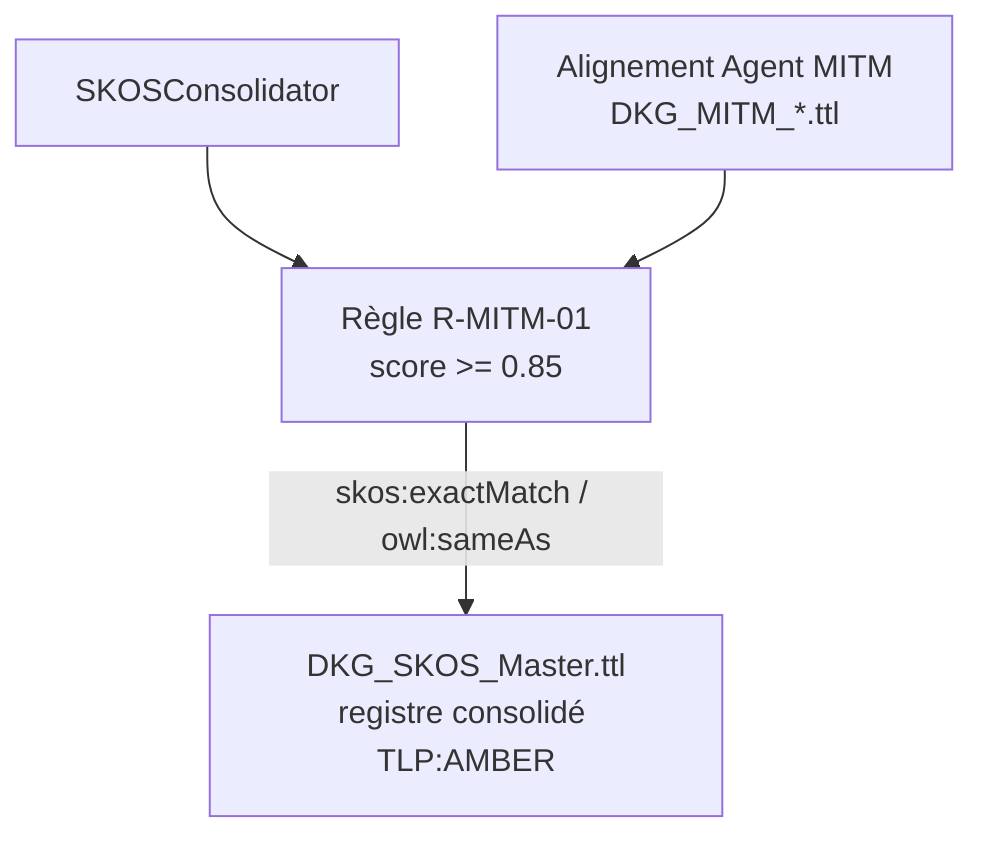

# 📑 Livrable Phase 5 - Registre de Consolidation SKOS (DKG_SKOS_Master)

**Classification :** `TLP:AMBER`  
**Nombre de triplets dans le registre consolidé :** `1`

---

## 📖 Glossaire & Table des Acronymes Métier

| Acronyme | Définition Complète | Contextualisation DKG |
| :--- | :--- | :--- |
| **OWL** | Web Ontology Language | Langage d'équivalence sémantique (`owl:sameAs`). |
| **SKOS** | Simple Knowledge Organization System | Normalisation du thésaurus (alignements `skos:exactMatch`). |
| **SSOT** | Single Source of Truth | Source unique de vérité (`core/config.py`). |
| **TBox** | Terminology Box | Définition du schéma sémantique — artefact opérateur vivant, hors de portée de ce script. |

---

## 🔄 Flux de Consolidation SKOS (R-MITM-01, spec SPC-TEC-P5-CONSO_01)

*Document généré automatiquement post-consolidation SKOS. La TBox Master (sas opérateur) n'est jamais réécrite par ce script.*
