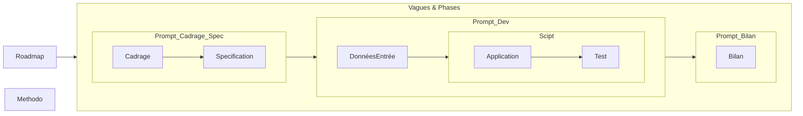

# DKG-CyberSec : Framework de Solution IA Agentique Basé sur les Graphes de Connaissance

Un Framework souverain pour concevoir des Graphes de Connaissances Dynamiques (DKG) sous la gouvernance stricte des standards W3C (OWL2, SKOS, SHACL), doté d'une sécurité et d'une isolation natives (Matrice TLP), et résolument **Green-by-Design & Local-First**.  
Le cas d'usage étalon didactique utilisé pour les démonstrateurs est un Security Operation Center (SOC) résidentiel et d'entreprise.

---

## Le Constat : Le Défi Humain & Informatique du "Sens Partagé"
Les ambiguïtés lexicales, le jargon cloisonné et la perte de contexte coûtent une énergie considérable et dégradent la qualité opérationnelle des équipes de sécurité.  
Les technologies d'IA basées sur les Graphes de Connaissances Dynamiques (DKG) apportent une solution pour partager le sens tout en respectant les niveaux de confidentialité. Cependant, pour éviter les fausses équivalences et les hallucinations, ces technologies doivent impérativement reposer sur une **Source Unique de Vérité (SSOT)** et être gouvernées par des standards formels (Closed World Assumption).

## La Vision & Les Piliers Techniques

> Triptyque fondateur *(acté 2026-10-19)* : **Connaissances · Confidentialité · Frugalité**. Intuition à démontrer (registre d'honnêteté méthodique, jamais un acquis) : l'IA frugale, locale, n'est pas incompatible avec la gestion de volumes. Le LLM propose sans jamais écrire ; le graphe garantit ce qui est écrit ; l'humain arbitre.
1. **Adhérence W3C Stricte (100% OWL2 / SKOS / SHACL) :** Traçabilité formelle, réversibilité et validation logique formelle.
2. **Sécurité & Isolation Native (TLP Matrix) :** Ségrégation absolue des flux (CLEAR, AMBER, RED) garantie par architecture et filtrage par passerelle.
3. **Green-by-Design & Local-First :** Calibré pour tourner en local et en mode Air-Gapped (poste standard de 16 Go de RAM, sans GPU dédié), minimisant l'empreinte carbone.
4. **L'Arbitrage de Rupture (W3C vs Moteurs Propriétaires) :** Évaluer empiriquement les limites de charge du modèle standard avant d'envisager, si nécessaire, une passerelle vers des moteurs de graphes non-standards (type Neo4j), tout en documentant formellement la perte sémantique associée.

|  |  |  |
| -------------------------------------------------------------------------------- | ----------------------------------------------------------------- | ----------------------------------------------------------------------------------------- |


---
## 🚦 État d'Avancement Macro (Roadmap par Vagues)

| Vague | Titre & Horizon | Sens & Principes Pédagogiques | Statut |
| :---: | :--- | :--- | :---: |
| **V1** | Socle Structurel & Cartographie Interne | (P1) Standards W3C (OWL2, SKOS, SHACL)<br>(P2) Confidentialité native (TLP:AMBER / TLP:RED).<br>Cas d'usage : PC individuel. | 🟢 PASSED |
| **V2** | Ingestion CTI, NER & Alignement Primitif | Superposition de graphes<br>Rapprochement sémantique et NER local.<br>Cas d'usage : CTI externe (NVD, CISA KEV) & texte brut. | 🟢 PASSED |
| **V3** | Industrialisation, Micro-Agents & Gateway | Structure IA Agentique et API Gateway sécurisée (Cross-TLP).<br>Cas d'usage : Micro-entreprise, passerelle SPARQL immutable. | 🟢 PASSED |
| **V4** | SOC_1 : Finalisation & Briques de Gouvernance | **Intégration du protocole MCP**, architecture multi-agents. Découpage Agile (acté 2026-11-17) : briques cœur développées seules (P9 : passerelle HITM, intégration EOL, llm_bridge), puis brique d'exposition (P10 : modélisation TBox des règles de filtrage & posture de durcissement, métrique d'exploitabilité, requêtes d'atteignabilité), puis mise en œuvre SOC_1 (P11 : Gardien ABox, rapport évolutionné vulnérabilité×exploitabilité, abaque 4 couches) clôturée par l'**arbitrage GO/NO-GO Neo4j**. État (2026-11-25) : étape de reprise close (CI vert, plancher NonReg 130 passed) ; P9 ACTIVE avec Brique 2 (Intégration EOL) ✔ PASSED ; P10 ACTIVE — vague EOL ouverte (spec SPC-FWK-P10-EOL_01, registre v2.5, commit a8b877d) : record SMBv1 dans le fonds, imbrication composants/actifs, adaptateur front. | 🟡 ACTIVE |
| **V5** | SOC_2 : Conformité RGPD & Taxonomies SKOS | Réutilise les briques de V4 sans nouvelle brique majeure attendue. Internationalisation (FR/EN), poly-hiérarchies, conformité RGPD/NIS2. | ⚪ Planifié |
| **V6** | SOC_3 : Logs & Surveillance | Montée en charge progressive, génération de deltas et abaques de performance, par la méthode abaque produite en V4. | ⚪ Planifié |
| **V7** | GraphRAG Hybride & Multi-Engine Neo4j | Assistant NL-to-SPARQL avancé et pont vers base de graphe propriétaire (n10s), **conditionnés par l'arbitrage chiffré de V4** (on ne s'engage qu'avec les chiffres), avec documentation formelle de la perte sémantique. | ⚪ Planifié |
| **V8** | SOC Distribué, Émulation Edge & SOAR | Calcul distribué (Map-Reduce SPARQL), génération de playbooks de remédiation et mesure de la sobriété. | ⚪ Planifié |

👉 **[Pour plus de détails sur la roadmap, consulter la Roadmap complète](Roadmap.md)**

|  | Pour exécuter les tests localement : `cd 03-Application && pytest` |
| ----------------------------------------------------------------------------------------- | ------------------------------------------------------------------------- |

---

## 2. Méthodologie & Co-Développement IA

Ce projet est aussi l'occasion d'innover dans la méthodologie. L'approche "Spec Driven" traditionnelle est appliquée, mais articulée avec :
- Le **développement assisté par LLM**, et les pratiques pour éviter les hallucinations et les dérives.
- Les outils : **Obsidian**

### 2.1. Méthode Spec Driven


### 2.2. Assistance LLM & Gestion de l'attention

- Ouvrir une nouvelle discussion à chaque Phase voire entre deux étapes si les échanges ont été trop nombreux.
    
- Garantir un recalage de contexte avec un certain nombre de données compactes :
    
    - Roadmap vision globale
        
    - Spécification et Exigence en format TSV
        
    - Partage d'un fichier rassemblant les variables, chemins, noms de fichiers et Namespaces (`03-Application/config.py`)
        

#### A. Les 3 Prompts d'étape

1. **Prompt 1 / Cadrage & Spécifications (`[CONTEXT: CADRAGE-SPEC]`) :** Validation des pré-requis, écriture des `SPEC-*.md` et modélisation TBox (interdiction de coder).
    
2. **Prompt 2 / Dev, Data & Tests (`[CONTEXT: DEV-DATA]`) :** Génération du code Python, ingestion RDF Turtle (`.ttl`) et validation PyTest/SHACL sous contrainte SSOT (`config.py`).
    
3. **Prompt 3 / Rétrospective 5S & Clôture (`[CONTEXT: RETRO-5S]`) :** Replay vers le Master, auto-documentation Markdown (`DOC_*.md`) et mise à jour d'état.
    

### 2.3. Outils (Obsidian & Plugins)

Obsidian s’avère être un outil particulièrement bien adapté. Il est recommandé de l'utiliser avec ses plugins :

- JupyMD
    
- Mermaid view
    
- VSCode Editor
    
- Templater
    
- DataView
    

## 3. Les Grands Principes du Framework

### 3.1 - Principes Pédagogiques

- **Usage des Standards W3C (OWL2, SKOS, SHACL)** : Modélisation formelle pour éviter tout enfer propriétaire.
    
- **Gouvernance & Qualité Stricte (SHACL CWA)** : Contrôle systématique aux portes d'entrée du graphe (_Closed World Assumption_).
    
- **Gestion de la Confidentialité (TLP)** : Marquage natif de la sensibilité de la donnée (`TLP:CLEAR`, `TLP:AMBER`, `TLP:RED`).
    
- **Standardisation Agentique (MCP)** : Utilisation du protocole MCP dès la Vague 4 pour exposer les ressources du graphe et les outils de validation de manière découplée.
    
- **Souveraineté & Sobriété** : Capacité d'exécution complète sur PC standard (16 Go RAM, sans GPU dédié).
    

### 3.2 - L'Articulation des Technologies : Qui fait quoi ? (Anti-Overlap)

Une idée reçue voudrait que la puissance des grands LLM permette de s'affranchir de la modélisation formelle ou du typage applicatif. **Notre approche prouve exactement l'inverse** : plus le LLM est puissant, plus ses garde-fous doivent être explicites pour garantir un résultat déterministe et souverain.

Chaque brique de l'architecture possède un rôle étanche et complémentaire :

```
┌─────────────────────────────────────────────────────────────────────────┐
│                           LLM / SLM LOCAL                               │
│  • Exploration textuelle, NER, formulation d'hypothèses, SPARQL RAG     │
└────────────────────────────────────┬────────────────────────────────────┘
                                     │ (Interface via MCP & Pydantic V2)
                                     ▼
┌─────────────────────────────────────────────────────────────────────────┐
│                      PYDANTIC V2 & config.py (SSOT)                     │
│  • Typage applicatif strict, Immutabilité, Adresses de fichiers (Path)  │
└────────────────────────────────────┬────────────────────────────────────┘
                                     │ (Injection & Validation)
                                     ▼
┌─────────────────────────────────────────────────────────────────────────┐
│                     STANDARDS W3C (OWL2, SKOS, SHACL)                   │
│  • Garde-fou formel, Raisonnement déterministe, Closed World (CWA)      │
└─────────────────────────────────────────────────────────────────────────┘
```

1. **`config.py` & Pydantic V2 (SSOT Code) :** Valide les chemins de fichiers, les variables d'environnement et les seuils avant d'interroger la mémoire RDF. Interdit toute chaîne de caractères en dur.
    
2. **Standards W3C (OWL2, SKOS, SHACL) (SSOT Métier) :** Garantit la cohérence logique. Une assertion proposée par l'IA est **rejetée sans sommation par SHACL** si elle ne respecte pas le schéma.
    
3. **Le LLM Collaborateur :** Capture l'ambiguïté du monde réel (texte brut CTI, logs non structurés) et traduit la complexité textuelle vers des structures validées par SHACL.
    

## 4. Structure du Référentiel

```
DKG-CYBERSEC/
├── 00-Projet/                          # Gouvernance, checklists, Roadmap et livrables Phase_Content.md
├── 01-Principes_Spécification/         # Spécifications canoniques (SPC-*) et registre d'exigences vivant (registry_exigences.json)
├── 02-Donnees/                         # Artefacts RDF Turtle (.ttl) — consolidation en delta Master direct (miroirs .md abrogés, Snapshots_Phases abrogé en 06-Archives)
│   ├── Input_Phases/                   # Seeds et fonds de recette par phase
│   └── Master_Transversal/             # Zones TLP : TBox AMBER · ABox Interne RED (Instances) · CTI Externe CLEAR · Infered RED · API_Gateway GREEN
└── 03-Application/                     # Outillage Python, agents IA, API Gateway et suites PyTest
```

👉 **[Pour plus de détails, consulter l'index fichiers _( certaines vues peuvent requérir l'autorisation JavaScript et/ou Obsidian)_](./00-Projet/Index_fichiers.md)**

## 5. Comment Utiliser

### 5.1. Installation de l'application
1. Cloner le répertoire GitHub.
2. Mettre en place un environnement virtuel avec le fichier `requirements.txt`.
3. Configurer Obsidian et ses plugins recommandés.
4. Lancer le backend `python 03-Application/main.py`
5. Connectez le front-end : `localhost:8000` dans le navigateur.
6. Sélectionnez différents "terrains", observez la TBox, l'ABox, tant en `.ttl` qu'en graphe.
7. Cochez les sources externes et lancez l'analyse. Observez les demandes de mise à jour de la TBox ainsi que les vulnérabilités remontées.
### 5.2. Développement - Évolution
1. Cloner le répository GitHub.
2. Mettre en place un environnement virtuel avec le fichier `requirements.txt`.
3. Configurer Obsidian et ses plugins recommandés.
4. Consulter les spécifications et exigences dans `01_Principes_Specification/` avec en particulier
   - `01.1 - Atelier_Gestion_Exigences_Tests.md` présentant l'état de suivi des couvertures d'exigences.
   - `01.2 - Architecture.md` présentant l'architecture.
5. Consultez les Données `02-Donnees`
6. Consulter l'arborescence et les script dans `03-Application` avec en particulier : 
   - le `core/config.py` qui contient tous les chemins utilisés en variable dans les scripts.
   - Le `Test/` contenant tous les scripts de test avec le marquage Non-Reg et en Doc-String la réference à l'exigence.

## 6. Réutilisation du Framework sur Votre Propre Domaine

Vous souhaitez adapter la méthode DKG-Framework à un autre cas d'usage (Santé, Finance, Logistique) ?

1. **Adoptez la démarche _Spec-Driven_ :** Adaptez les exigences formelles dans `01-Principes_Spécification/USECASE_METIER/`.
    
2. **Adaptez les données d'entrées :** Placez vos données dans `02-Donnees/Input_Phases/`.
    
3. **Relancez les scripts :** Exécutez les scripts de chaque phase pour reconstruire TBox et ABox.
    
4. **Interagissez avec le LLM :** Respectez les consignes de partage de données et de génération de contextes de fin de phase.


## 7. Dette de versions


> ✅ **Dette de données résolue (2026-11-25, étape de reprise)** : la zone `Snapshots_Phases/` a été **abrogée physiquement** (19 fichiers déplacés en `06-Archives/Snapshots_Phases_Historique`, commit a015a37). Les zones Master sont régénérées en **delta direct** depuis les rejeus `03-Application/phases/PhaseX/` (fusion abrogée). La régénération depuis les seeds et la TBox Master v3 est la seule voie de reconstruction ; tout Master non rejouable à l'identique est suspect de pollution manuelle.